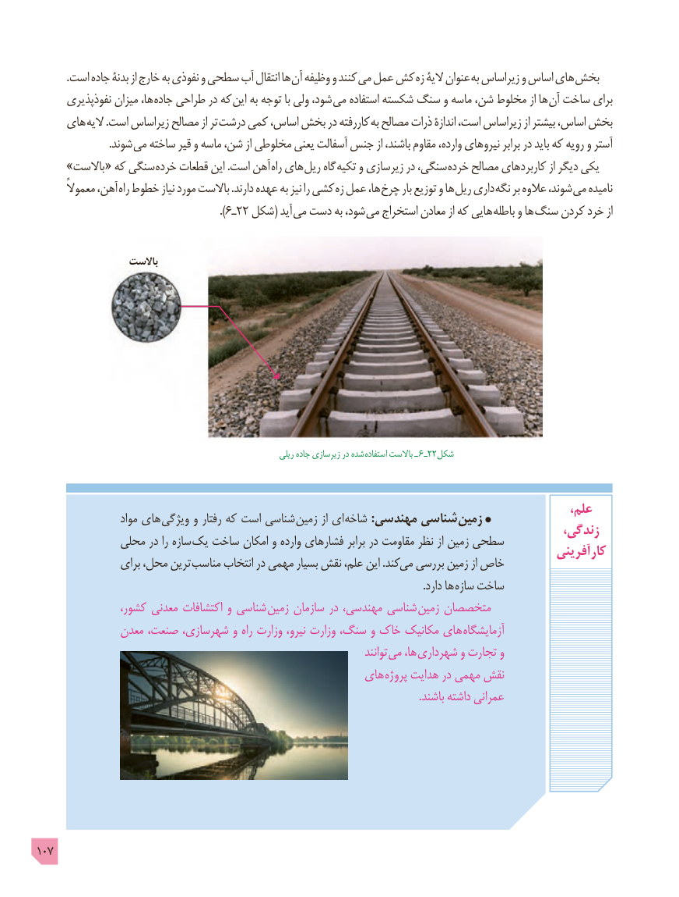

# PDF page 107

.است جاده بدنۀ از خارج به نفوذی و سطحی آب انتقال ها آن وظیفه و کنند می عمل کش زه الیۀ عنوان به زیراساس و اساس های بخش
      نفوذپذیری میزان ها، جاده طراحی در که این به توجه با ولی شود، می استفاده شکسته سنگ و ماسه شن، مخلوط از ها آن ساخت برای
     های الیه .است زیراساس مصالح از تر درشت کمی اساس، بخش در کاررفته به مصالح ذرات اندازۀ است، زیراساس از بیشتر اساس، بخش
     . شوند می ساخته قیر و ماسه شن، از مخلوطی یعنی آسفالت جنس از باشند، مقاوم وارده، نیروهای برابر در باید که رویه و آستر
     »باالست « که سنگی خرده قطعات این .است آهن راه های ریل گاه تکیه و زیرسازی در سنگی، خرده مصالح کاربردهای از دیگر یکی
       معموالً آهن، راه خطوط نیاز مورد باالست .دارند عهده به نیز را کشی زه عمل ها، چرخ بار توزیع و ها ریل داری نگه بر عالوه شوند، می نامیده
                                            ).6ـ22 شکل( آید می دست به شود، می استخراج معادن از که هایی باطله و ها سنگ کردن خرد از

                   باالست

                                                                  ریلی جاده زیرسازی در شده  استفاده باالست ـ 6 ـ22شکل

                                                                                               ،علم                   مواد های ویژگی و رفتار که است شناسی زمین از ای شاخه :مهندسی شناسی زمین                                                                                        زندگی،             محلی در را سازه  یک ساخت امکان و وارده فشارهای برابر در مقاومت نظر از زمین سطحی                                                                                            آفرینی  کار                 برای محل، ترین  مناسب انتخاب در مهمی بسیار نقش علم، این .کند می بررسی زمین از خاص
                      . دارد ها سازه ساخت
                کشور، معدنی اکتشافات و شناسی زمین سازمان در مهندسی، شناسی زمین متخصصان
              معدن صنعت، شهرسازی، و راه وزارت نیرو، وزارت سنگ، و خاک مکانیک های آزمایشگاه
                                                                                      توانند می ها، شهرداری و تجارت و
                                                   های پروژه هدایت در مهمی نقش
                                                                                                                                                .باشند داشته عمرانی

107

