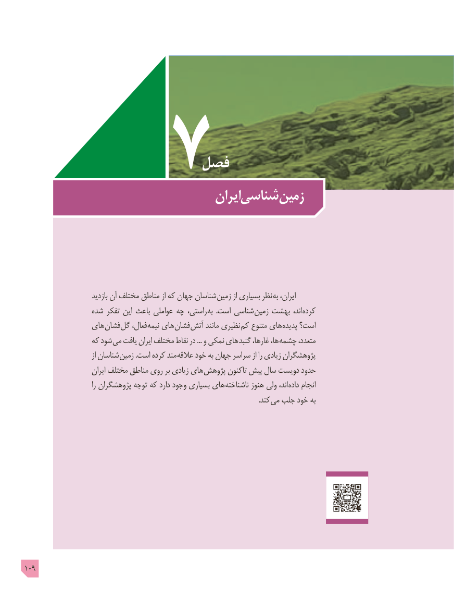

# PDF page 109

فصل
                                    ایرانشناسی زمین

                         بازدید آن مختلف مناطق از که جهان شناسان زمین از بسیاری نظر به ایران،
                 شده تفکر این باعث عواملی چه راستی، به  .است شناسی زمین بهشت اند، کرده
                های فشان گل فعال، نیمه های فشان آتش مانند نظیری کم متنوع های پدیده است؟
                 که شود می یافت ایران مختلف نقاط در ... و نمکی های گنبد غارها، ها، چشمه متعدد،
                               از شناسان زمین .است کرده مند عالقه خود به جهان سراسر از را زیادی پژوهشگران
                        ایران مختلف مناطق روی بر زیادی های پژوهش تاکنون پیش سال دویست حدود
                               را پژوهشگران توجه که دارد وجود بسیاری های ناشناخته هنوز ولی اند، داده انجام
                                                                                                                                    .کند می جلب خود به

109

