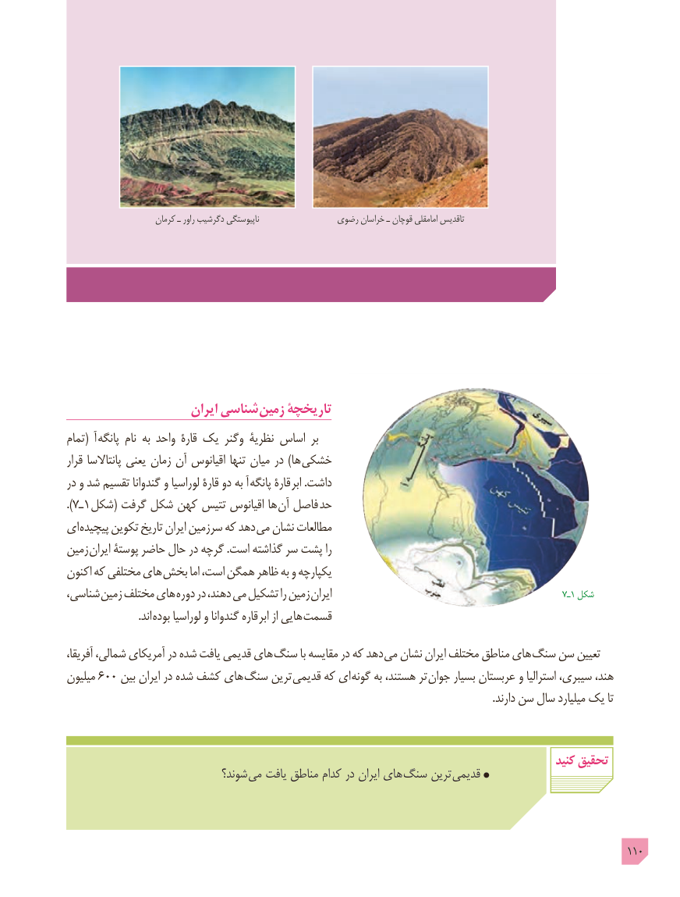

# PDF page 110

کرمان ـ راور دگرشیب ناپیوستگی               رضوی خراسان ـ قوچان امامقلی تاقدیس

                       ایران شناسی زمین تاریخچۀ
تمام(  آ  پانگه نام به واحد قارۀ یک وگنر نظریۀ اساس بر
قرار پانتاالسا یعنی زمان آن اقیانوس تنها میان در )ها  خشکی
در و شد تقسیم گندوانا و لوراسیا قارۀ دو به آ پانگه قارۀ  ابر .داشت
).7ـ1 شکل( گرفت شکل کهن تتیس اقیانوس ها آن فاصل حد
ای پیچیده تکوین تاریخ ایران سرزمین که دهد  می نشان مطالعات
زمین  ایران پوستۀ حاضر حال در گرچه .است گذاشته سر پشت را
اکنون که مختلفی های  بخش اما است، همگن ظاهر به و یکپارچه
شناسی، زمین مختلف های دوره در دهند، می تشکیل را زمین ایران                                                 7ـ1 شکل
        . اند بوده لوراسیا و گندوانا قاره  ابر از هایی  قسمت
آفریقا، شمالی، آمریکای در شده یافت قدیمی های سنگ با مقایسه در که دهد می نشان ایران مختلف مناطق های سنگ سن تعیین
میلیون 600 بین ایران در شده کشف های سنگ ترین قدیمی که ای گونه به هستند، تر جوان بسیار عربستان و استرالیا سیبری، هند،
                                                                                                                                                                .دارند سن سال میلیارد یک تا

                                                                                                   کنید تحقیق
                              شوند؟ می یافت مناطق کدام در ایران های سنگ ترین قدیمی

                                                                                                 110

