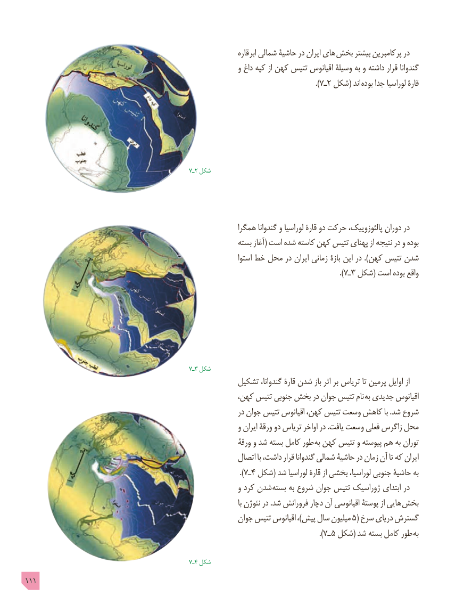

# PDF page 111

قاره  ابر شمالی حاشیۀ در ایران های بخش بیشتر پرکامبرین در
                                                                و داغ کپه از کهن تتیس اقیانوس وسیلۀ به و داشته قرار گندوانا
                                                                                                      ).7ـ2 شکل( اند بوده جدا لوراسیا قارۀ

                                                   7ـ2 شکل

                                                           همگرا گندوانا و لوراسیا قارۀ دو حرکت پالئوزوییک، دوران در
                                                             بسته آغاز( است شده کاسته کهن تتیس پهنای از نتیجه در و بوده
                                                                            استوا خط محل در ایران زمانی بازۀ این در ).کهن تتیس شدن
                                                                                                               ).7ـ3 شکل( است بوده واقع

                                                   7ـ3 شکل
                                                   تشکیل گندوانا، قارۀ شدن باز اثر بر تریاس تا پرمین اوایل از
                                                     کهن، تتیس جنوبی بخش در جوان تتیس نام  به جدیدی اقیانوس
                                                                   در جوان تتیس اقیانوس کهن، تتیس وسعت کاهش با .شد شروع
                                                                و ایران ورقۀ دو تریاس اواخر در .یافت وسعت فعلی زاگرس محل
                                                                 ورقۀ و شد بسته کامل طور به کهن تتیس و پیوسته هم به توران
                                                            اتصال با داشت، قرار گندوانا شمالی حاشیۀ در زمان آن تا که ایران
                                                                            ).7ـ4 شکل( شد لوراسیا قارۀ از بخشی لوراسیا، جنوبی حاشیۀ به
                                                                و کرد شدن  بسته به شروع جوان تتیس ژوراسیک ابتدای در
                                                                                                           با نئوژن در .شد فرورانش دچار آن اقیانوسی پوستۀ از هایی بخش
                                                        جوان تتیس اقیانوس ،)پیش سال میلیون 5( سرخ دریای گسترش
                                                                                                        ).7ـ 5 شکل( شد بسته کامل طور به

                                                   7ـ4 شکل
111

