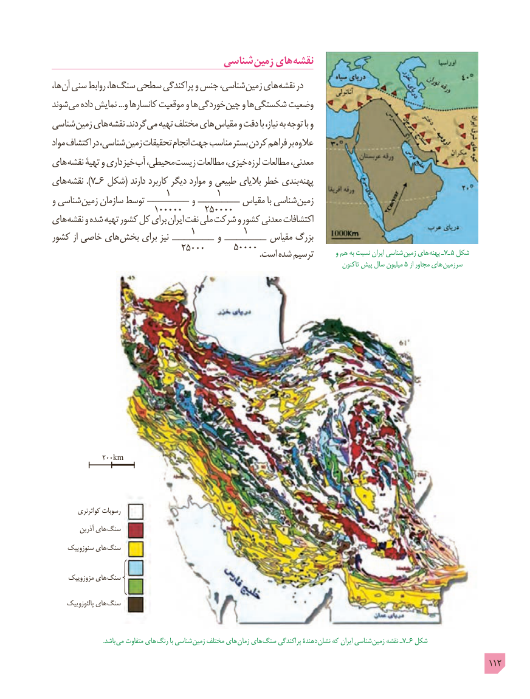

# PDF page 112

شناسی زمین های نقشه
ها، آن سنی روابط ها، سنگ سطحی پراکندگی و جنس شناسی، زمین های نقشه در
شوند می داده نمایش ...و کانسارها موقعیت و ها خوردگی چین و ها شکستگی وضعیت
شناسی زمین های نقشه .گردند می تهیه مختلف های مقیاس و دقت با نیاز، به توجه با و
مواد اکتشاف در شناسی، زمین تحقیقات انجام جهت مناسب بستر کردن فراهم بر عالوه
های نقشه تهیۀ و داری خیز آب محیطی، زیست مطالعات خیزی، لرزه مطالعات معدنی،
های ).نقشه 7ـ 6  شکل( دارند کاربرد دیگر موارد و طبیعی بالیای خطر بندی پهنه
                       1         1و شناسی زمین سازمان توسط _______ و _______ مقیاس با شناسی زمین                     100000     250000های نقشه و شده تهیه کشور کل برای ایران نفت ملی شرکت و کشور معدنی اکتشافات
                            1          1کشور از خاصی های بخش برای نیز _______ و _______ مقیاس بزرگ
                           25000      50000                                                                                                    .است شده ترسیم        و هم به نسبت ایران شناسی زمین های  پهنه ـ7ـ 5 شکل
                                                                                                       تاکنون پیش سال میلیون 5 از مجاور های  سرزمین

            200km

         کواترنری رسوبات
          آذرین های  سنگ
     سنوزوییک های سنگ

     مزوزوییک های سنگ

     پالئوزوییک های  سنگ

                                 .باشد می متفاوت هاي  رنگ با شناسی  زمین مختلف هاي زمان هاي  سنگ پراکندگی دهندة نشان که ایران شناسی زمین نقشه ـ7ـ 6 شکل
                                                                                                 112

