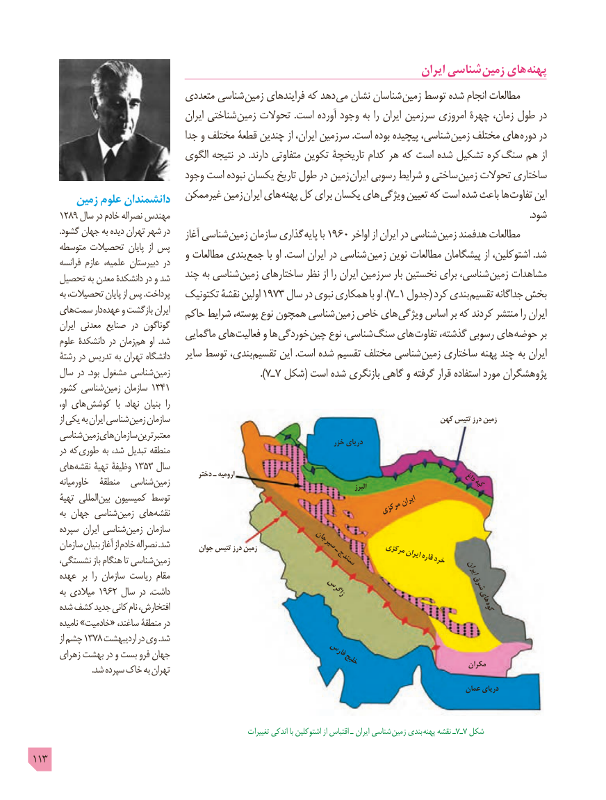

# PDF page 113

ایران شناسی زمین های پهنه
                               متعددی شناسی زمین فرایندهای که دهد می نشان شناسان زمین توسط شده انجام مطالعات
                                         ایران شناختی زمین تحوالت .است آورده وجود به را ایران سرزمین امروزی چهرۀ زمان، طول در
                                   جدا و مختلف قطعۀ چندین از ایران، سرزمین .است بوده پیچیده شناسی، زمین مختلف های دوره در
                                الگوی نتیجه در .دارند متفاوتی تکوین تاریخچۀ کدام هر که است شده تشکیل کره سنگ هم از
                                وجود است نبوده یکسان تاریخ طول در زمین ایران رسوبی شرایط و ساختی زمین تحوالت ساختاری
                             غیرممکن زمین ایران های پهنه کل برای یکسان های ویژگی تعیین که است شده باعث ها تفاوت این        زمین علوم دانشمندان
      1289 سال در خادم نصراله مهندس                                                                                                                                                        .شود
             .گشود جهان به دیده تهران شهر در    آغاز شناسی زمین سازمان گذاری پایه با 1960 اواخر از ایران در شناسی زمین هدفمند مطالعات
      متوسطه تحصیالت پایان  از پس                                   و مطالعات بندی جمع با او .است ایران در شناسی زمین نوین مطالعات پیشگامان از اشتوکلین، .شد        فرانسه عازم علمیه، دبیرستان در
     تحصیل به معدن دانشکدۀ در و شد   چند به شناسی زمین ساختارهای نظر از را ایران سرزمین بار نخستین برای شناسی، زمین مشاهدات
        به تحصیالت، پایان از پس .پرداخت   تکتونیک نقشۀ اولین 1973 سال در نبوی همکاری با او ). 7ـ 1 جدول( کرد بندی تقسیم جداگانه بخش
     های سمت دار عهده و بازگشت ایران   حاکم شرایط پوسته، نوع همچون شناسی زمین خاص های ویژگی اساس بر که کردند منتشر را ایران        ایران معدنی صنایع در گوناگون                                   ماگمایی های فعالیت و ها خوردگی چین نوع شناسی، سنگ های تفاوت گذشته، رسوبی های حوضه بر       علوم دانشکدۀ در زمان هم او  .شد
       رشتۀ در تدریس به تهران دانشگاه    سایر توسط بندی، تقسیم این .است شده تقسیم مختلف شناسی زمین ساختاری پهنه چند به ایران
      سال در  .بود مشغول شناسی زمین                         ).7ـ 7  شکل( است شده بازنگری گاهی و گرفته قرار استفاده مورد پژوهشگران
      کشور شناسی زمین سازمان 1341
    ،هایاو        کوشش  با  .نهاد بنیان  را
           از یکی به ایران شناسی زمین سازمان                                                              کهن تتیس درز زمین
      شناسی زمین های سازمان معتبرترین                                                                                  خزر دریای
        در که طوری به شد، تبدیل منطقه
     های نقشه تهیۀ وظیفۀ 1353 سال
        خاورمیانه   منطقۀ  شناسی زمین        دختر ـ ارومیه                                                 البرز                   داغکپه
       تهیۀ المللی بین کمیسیون توسط                                                             ایران                                                                           مرکزی        به جهان شناسی زمین های نقشه
       سپرده ایران شناسی زمین سازمان
       سازمان بنیان آغاز از خادم نصراله .شد        جوان تتیس درز زمین             سیرجانـ         مرکزی
                                                                                                               قارهخرد      نشستگی، باز هنگام تا شناسی زمین                                    سنندج             ایران                                                                                                                       ایران      عهده بر  را سازمان ریاست مقام
        به میالدی 1962 سال در  .داشت                                زاگرس                    شرق                                                                               های       شده کشف جدید کانی نام افتخارش،                                                          کوه
         نامیده »خادمیت« ساغند، منطقۀ در
           از چشم 1378 اردیبهشت در وی .شد
      زهرای بهشت در و بست فرو جهان                             فارس                                                                 خلیج                              مکران                             .شد سپرده خاک به تهران
                                                                                                                    عمان دریای

                                                                      تغییرات اندکی با اشتوکلین از اقتباس ـ ایران شناسی  زمین بندي  پهنه نقشه ـ7ـ7 شکل
113

