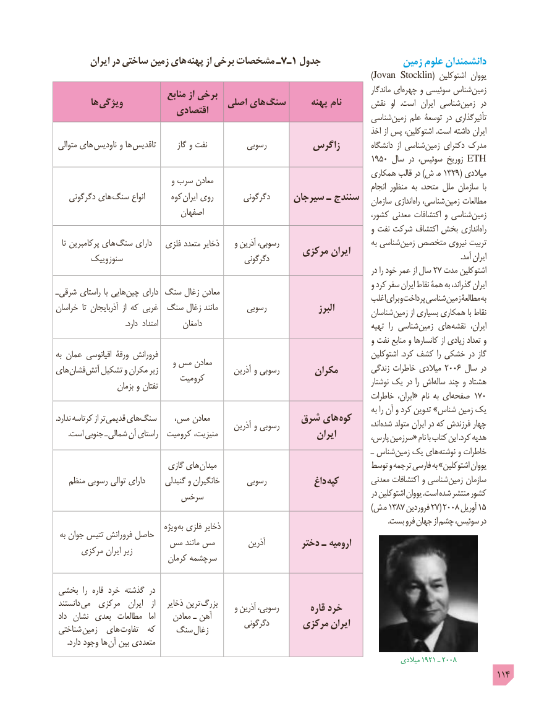

# PDF page 114

ایران در ساختی زمین های پهنه از برخی مشخصات ـ7ـ1 جدول                 زمین علوم دانشمندان
                                                                            )Jovan Stocklin( اشتوکلین یووان
                                                                                                                ماندگار ای چهره و سوئیسی شناس زمین                              منابع از برخی         ها ویژگی                     اصلی های  سنگ      پهنه نام      نقش  او   .است  ایران شناسی زمین  در                          اقتصادی                                                                            شناسی زمین علم توسعۀ در تأثیرگذاری
                                                                                               اخذ از پس اشتوکلین، .است داشته ایران
 متوالی های  ناودیس و ها تاقدیس       گاز و نفت          رسوبی        زاگرس          دانشگاه  از شناسی زمین دکترای مدرک
                                                                           1950 سال در سوئیس، زوریخ ETH
                                                                            همکاری قالب در )ش .ه 1329( میالدی                                 و سرب معادن                                                                                                          انجام منظور به متحد، ملل سازمان  با
   دگرگونی های سنگ انواع       کوه ایران روی        دگرگونی     سیرجان ـ سنندج                                                                                           سازمان اندازی راه شناسی، زمین مطالعات
                                اصفهان                                               کشور، معدنی اکتشافات و شناسی زمین
                                                                                             و نفت شرکت اکتشاف بخش اندازی راه
   تا پرکامبرین های  سنگ دارای   فلزی متعدد ذخایر    و آذرین رسوبی،                               به شناسی زمین متخصص نیروی تربیت                                                مرکزی ایران         سنوزوییک                                 دگرگونی                                                                                                        .آمد ایران
                                                                                                     در را خود عمر از سال 27 مدت اشتوکلین
                                                                                             و کرد سفر ایران نقاط همۀ به گذراند، ایرانـ شرقی راستای با هایی چین دارای سنگ زغال معادن                                                                                     اغلب برای و پرداخت شناسی زمین مطالعۀ به
خراسان  تا آذربایجان  از که غربی  سنگ زغال مانند       رسوبی                البرز                                                                                     شناسان زمین از بسیاری همکاری با نقاط
                                     .دارد  امتداد       دامغان                                                                                                 تهیه  را شناسی زمین های نقشه  ایران،
                                                                                             و نفت منابع و کانسارها از زیادی تعداد و
به عمان اقیانوسی ورقۀ فرورانش                                                               اشتوکلین  .کرد کشف را خشکی در گاز                                  و مس معادنهای فشان آتش تشکیل و مکران زیر                      آذرین و رسوبی       مکران         زندگی خاطرات میالدی 2006 سال در                              کرومیت                                                                                                          نوشتار یک در را اش ساله چند و هشتاد                  بزمان و تفتان
                                                                                  خاطرات ایران،« نام به ای صفحه 170
                                                                                                           به را آن و کرد تدوین »شناس زمین یک.ندارد کرتاسه از تر قدیمی های سنگ   مس، معادن              شرق های کوه                                                   آذرین و رسوبی                                        اند، شده متولد ایران در که فرزندش چهار . است جنوبی ـ شمالی آن راستای  کرومیت منیزیت،                         ایران                                                                                        پارس، سرزمین« نام با کتاب این .کرد هدیه
                                                                                                   ـ شناس زمین یک های نوشته و خاطرات
                            گازی های میدان                                    توسط و ترجمه فارسی به »اشتوکلین یووان
   منظم رسوبی توالی دارای      گنبدلی و خانگیران       رسوبی           داغ  کپه         معدنی اکتشافات و شناسی زمین سازمان
                                                                                                     در اشتوکلین یووان .است شده منتشر کشور                      سرخس
                                                                                                                                  )ش.ه 1387 فروردین 27( 2008 آوریل 15
                                                                                                                                                                                     .بست فرو جهان از چشم سوئیس، در                                  ویژه به فلزی ذخایر به جوان تتیس فرورانش حاصل                 مس مانند مس          آذرین        دختر ـ ارومیه      مرکزی ایران زیر                             کرمان سرچشمه

 بخشی  را  قاره خرد گذشته در
 دانستند  می  مرکزی   ایران   از   ذخایر ترین  بزرگ                                                    و آذرین رسوبی،        قاره خرد داد  نشان  بعدی  مطالعات   اما     معادن ـ آهن                                                    دگرگونی      مرکزی  ایران شناختی زمین  های تفاوت  که    سنگ زغال
 . دارد وجود ها آن بین متعددی
                                                                                                            میالدی 1921 ـ 2008
                                                                                                 114

