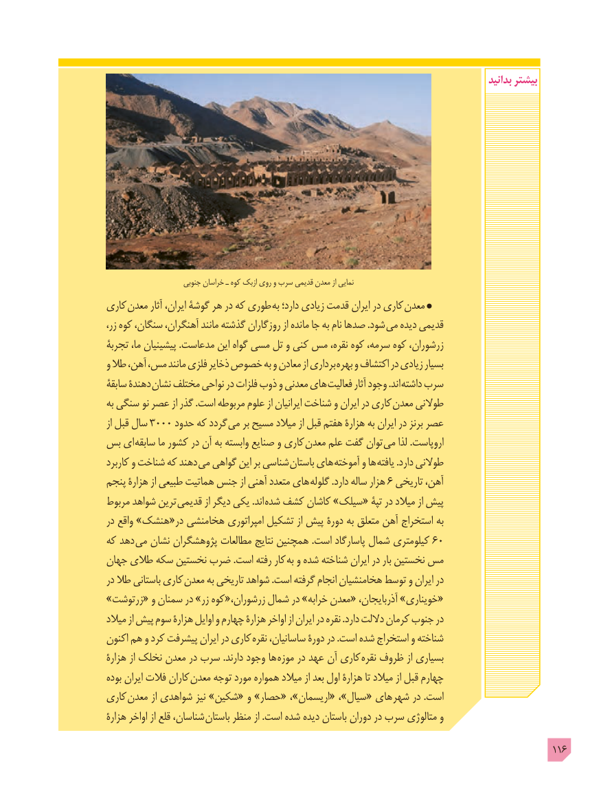

# PDF page 116

بدانید بیشتر

                      جنوبی خراسان ـ کوه ازبک روی و سرب قدیمی معدن از نمایی
کاری معدن آثار ایران، گوشۀ هر در که طوری  به دارد؛ زیادی قدمت ایران در کاری  معدن
،شودزر کوه سنگان، آهنگران، مانند گذشته روزگاران از مانده جا به نام صدها .      می دیده قدیمی
تجربۀ ما، پیشینیان .مدعاست این گواه مسی تل و کنی مس نقره، کوه سرمه، کوه زرشوران،
و طال آهن، مس، مانند فلزی ذخایر خصوص به و معادن از برداری بهره و اکتشاف در زیادی بسیار
سابقۀ دهندۀ نشان مختلف نواحی در فلزات ذوب و معدنی های فعالیت آثار وجود .اند  داشته سرب
به سنگی نو عصر از گذر .است مربوطه علوم از ایرانیان شناخت و ایران در کاری معدن طوالنی
از قبل سال 3000 حدود که گردد می بر مسیح میالد از قبل هفتم هزارۀ به ایران در برنز عصر
بس ای  سابقه ما کشور در آن به وابسته صنایع و کاری  معدن علم گفت توان می لذا .اروپاست
کاربرد و شناخت که دهند می گواهی این بر شناسی  باستان های آموخته و ها یافته .دارد طوالنی
پنجم هزارۀ از طبیعی هماتیت جنس از آهنی متعدد های  گلوله .دارد ساله هزار 6 تاریخی آهن،
مربوط شواهد ترین قدیمی از دیگر یکی .اند  شده کشف کاشان »سیلک« تپۀ در میالد از پیش
در واقع »هنشک«در هخامنشی امپراتوری تشکیل از پیش دورۀ به متعلق آهن استخراج به
که دهد می نشان پژوهشگران مطالعات نتایج همچنین .است پاسارگاد شمال کیلومتری 60
جهان طالی سکه نخستین ضرب .است رفته کار  به و شده شناخته ایران در بار نخستین مس
در طال باستانی کاری  معدن به تاریخی شواهد .است گرفته انجام هخامنشیان توسط و ایران در
»زرتوشت« و سمنان در »زر کوه«زرشوران، شمال در »خرابه معدن« آذربایجان، »خویناری«
میالد از پیش سوم هزارۀ اوایل و چهارم هزارۀ اواخر از ایران در نقره .دارد داللت کرمان جنوب در
اکنون هم و کرد پیشرفت ایران در کاری  نقره ساسانیان، دورۀ در .است شده استخراج و شناخته
هزارۀ از نخلک معدن در سرب .دارند وجود ها  موزه در عهد آن کاری  نقره ظروف از بسیاری
بوده ایران فالت کاران معدن توجه مورد همواره میالد از بعد اول هزارۀ تا میالد از قبل چهارم
کاری  معدن از شواهدی نیز »شکین« و »حصار« ،»اریسمان« ،»سیال« های شهر در .است
هزارۀ اواخر از قلع شناسان،  باستان منظر از .است شده دیده باستان دوران در سرب متالوژی و
                                                                                        116

