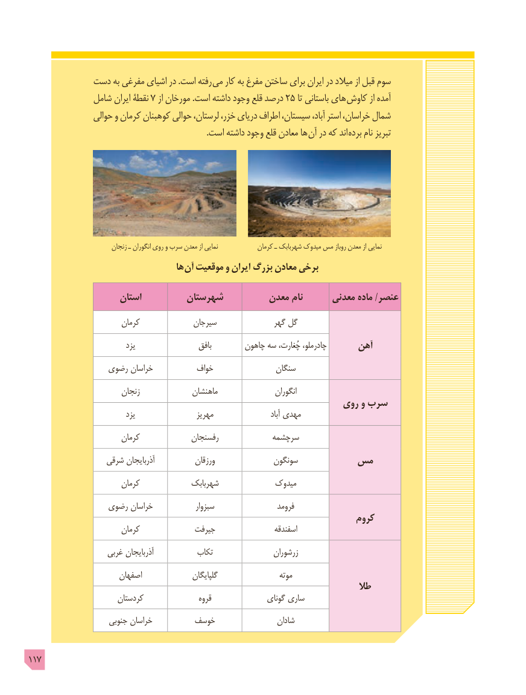

# PDF page 117

دست به مفرغی اشیای در .است رفته  می کار به مفرغ ساختن برای ایران در میالد از قبل سوم
              شامل ایران نقطۀ 7 از مورخان .است داشته وجود قلع درصد 25 تا باستانی های  کاوش از آمده
                 حوالی و کرمان کوهبنان حوالی لرستان، خزر، دریای اطراف سیستان، آباد، استر خراسان، شمال
   . است داشته وجود قلع معادن ها آن در که اند  برده نام تبریز

                           زنجان ـ انگوران روي و سرب معدن از نمایی             کرمان ـ شهربابک میدوک مس روباز معدن از نمایی
                                       ها آن موقعیت و ایران  بزرگ معادن برخی

                     استان         شهرستان         معدن نام      معدنی ماده /عنصر
                         کرمان              سیرجان               گهر گل
                               یزد                   بافق        چاهون سه چُغارت، چادرملو،      آهن
                رضوی خراسان          خواف                سنگان
                         زنجان              ماهنشان                  انگوران
                                                            روی و سرب
                               یزد                  مهریز                        آباد مهدی
                         کرمان             رفسنجان            سرچشمه
                  شرقی آذربایجان            ورزقان              سونگون       مس
                         کرمان             شهربابک             میدوک
                رضوی خراسان             سبزوار                  فرومد
                                                                     کروم
                         کرمان             جیرفت                  اسفندقه
                    غربی آذربایجان           تکاب                 زرشوران
                        اصفهان                گلپایگان                   موته
                                                                                  طال
                        کردستان                 قروه               گونای ساری
                      جنوبی خراسان        خوسف                 شادان

117

