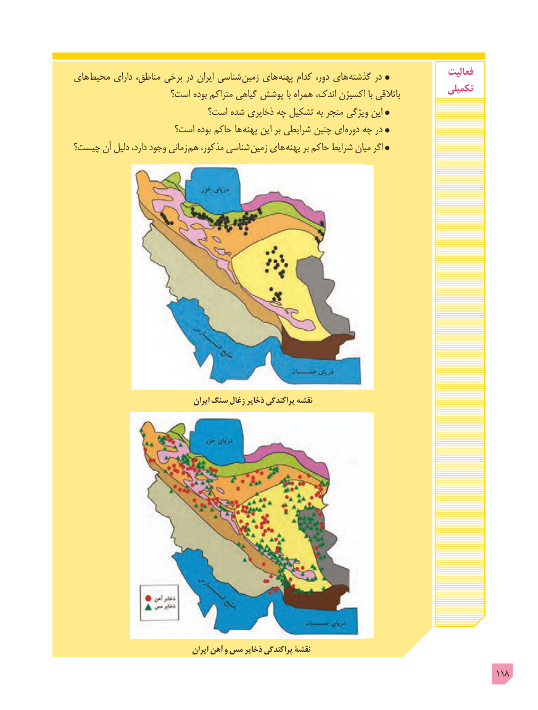

# PDF page 118

های محیط دارای مناطق، برخی در ایران شناسی  زمین های پهنه کدام دور، های گذشته در                فعالیت
                                                                                     تکمیلی                    است؟ بوده متراکم گیاهی پوشش با همراه اندک، اکسیژن با باتالقی
                           است؟ شده ذخایری چه تشکیل به منجر ویژگی این
                     است؟ بوده حاکم ها پهنه این بر شرایطی چنین ای دوره چه در
چیست؟ آن دلیل دارد، وجود زمانی هم مذکور، شناسی زمین های پهنه بر حاکم شرایط میان اگر

                                     ایران سنگ زغال ذخایر پراکندگی نقشه

                                    ایران آهن و مس ذخایر پراکندگی نقشۀ
                                                                                             118

