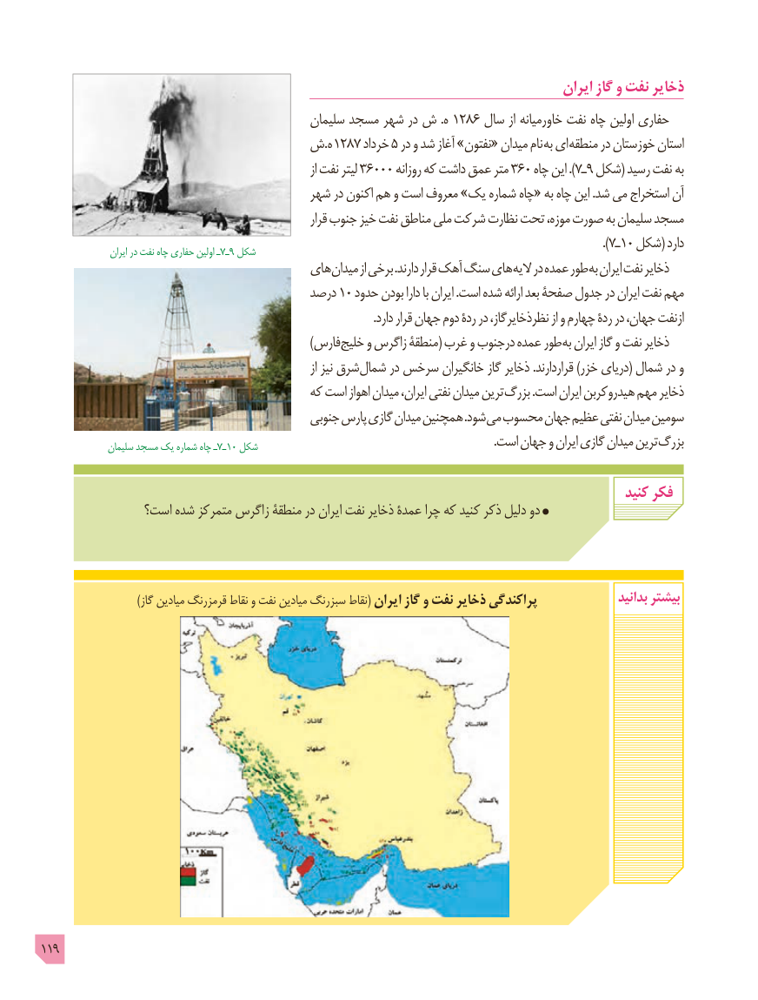

# PDF page 119

ایران گاز و نفت ذخایر
                                              سلیمان مسجد شهر در ش .ه 1286 سال از خاورمیانه نفت چاه اولین حفاری
                  ش.ه 1287 خرداد 5 در و شد آغاز »نفتون« میدان نام به ای منطقه در خوزستان استان
                                                                             از نفت لیتر 36000 روزانه که داشت عمق متر 360 چاه این ). 7ـ٩ شکل( رسید نفت به
                                       شهر در اکنون هم و است معروف »یک شماره چاه« به چاه این .شد می استخراج آن
                                                               قرار جنوب خیز نفت مناطق ملی شرکت نظارت تحت موزه، صورت به سلیمان مسجد
                                                                                                                            ).7ـ1٠ شکل( دارد                    ایران در نفت چاه حفاري اولین ـ7ـ٩ شکل
                                      های میدان از برخی .دارند قرار آهک سنگ های الیه در عمده طور به ایران نفت ذخایر
                                         درصد 10 حدود بودن دارا با ایران .است شده ارائه بعد صفحۀ جدول در ایران نفت مهم
                                                                                                                .دارد قرار جهان دوم ردۀ در نظرذخایرگاز، از و چهارم ردۀ در جهان، ازنفت
                                                                     )فارس خلیج و زاگرس منطقۀ( غرب و درجنوب عمده طور به ایران گاز و نفت ذخایر
                                                                             از نیز شرق شمال در سرخس خانگیران گاز ذخایر .قراردارند )خزر دریای( شمال در و
                                          که است اهواز میدان ایران، نفتی میدان ترین بزرگ .است ایران هیدروکربن مهم ذخایر
                                             جنوبی پارس گازی میدان همچنین .شود می محسوب جهان عظیم نفتی میدان سومین
               سلیمان مسجد یک شماره چاه ـ7ـ10 شکل   . است جهان و ایران گازی میدان ترین بزرگ

                                                                                                  کنید فکر
               است؟ شده متمرکز زاگرس منطقۀ در ایران نفت ذخایر عمدۀ چرا که کنید ذکر دلیل دو

                            )گاز میادین قرمزرنگ نقاط و نفت میادین سبزرنگ نقاط( ایران گاز و نفت ذخایر پراکندگی                بدانید بیشتر

119

