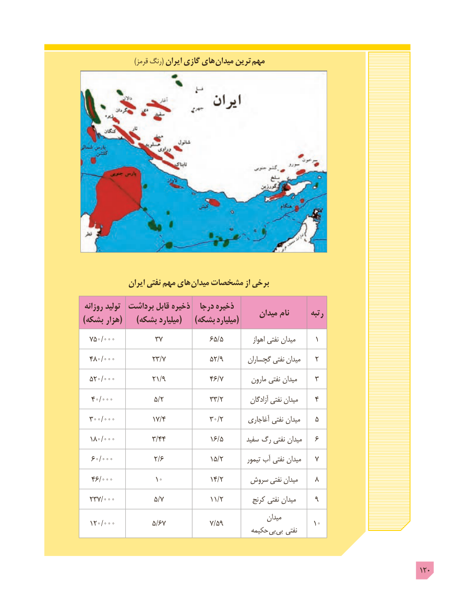

# PDF page 120

)قرمز رنگ( ایران گازی های  میدان ترین مهم

              ایران نفتی مهم های میدان مشخصات از برخی

روزانه تولید  برداشت قابل ذخیره   درجا ذخیره                                                میدان نام       رتبه) بشکه هزار(     )بشکه میلیارد(     )بشکه میلیارد(
  ۷۵۰/۰۰۰           ۳۷              65/5            اهواز نفتی ۱میدان
  48۰/۰۰۰           23/7             52/9       گچساران نفتی ۲میدان
  52۰/۰۰۰           21/9             46/7         مارون نفتی ۳میدان
  4۰/۰۰۰            5/2             33/2          آزادگان نفتی ۴میدان
  3۰۰/۰۰۰           17/4            3۰/2        آغاجاری نفتی ۵میدان
  18۰/۰۰۰           3/44             16/5  ۶سفید  رگ نفتی میدان
  6۰/۰۰۰            2/6             15/2         تیمور آب نفتی ۷میدان
   46/۰۰۰           ۱۰              14/2      سروش نفتی ۸میدان
  237/۰۰۰            5/7             11/2         کرنج نفتی ۹میدان
                                                              میدان
  12۰/۰۰۰           5/67   نفتی۷/۵۹        حکیمه بی بی        ۱۰

                                                                                       120

