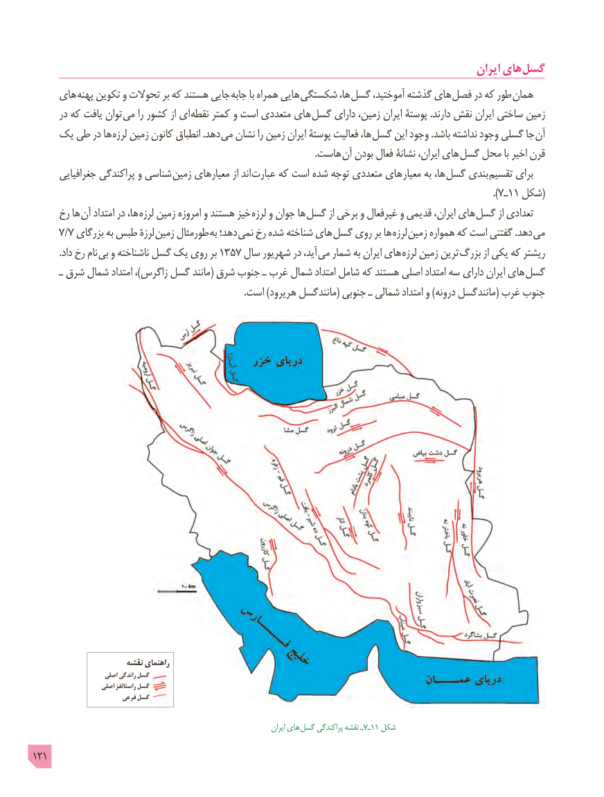

# PDF page 121

ایران های گسل
     های پهنه تکوین و تحوالت بر که هستند جایی  جابه با همراه هایی  شکستگی ها، گسل آموختید، گذشته های فصل در که طور همان
      در که یافت توان  می را کشور از ای  نقطه کمتر و است متعددی های گسل دارای زمین، ایران پوستۀ .دارند نقش ایران ساختی زمین
    یک طی در ها لرزه زمین کانون انطباق .دهد می نشان را زمین ایران پوستۀ فعالیت ها،  گسل این وجود .باشد نداشته وجود گسلی جا آن
                   . هاست آن بودن فعال نشانۀ ایران، های گسل محل با اخیر قرن
       جغرافیایی پراکندگی و شناسی زمین معیارهای از اند عبارت که است شده توجه متعددی های  معیار به ها، گسل بندی تقسیم برای
                                                                                                                                                                        ).7ـ1١ شکل(
     رخ ها  آن امتداد در ها، لرزه زمین امروزه و هستند خیز لرزه و جوان ها گسل از برخی و غیرفعال و قدیمی ایران، های گسل از تعدادی
     7/7 بزرگای به طبس لرزۀ  زمین طورمثال به دهد؛ نمی رخ شده شناخته های گسل روی بر ها  لرزه  زمین همواره که است گفتنی .دهد  می
           .داد رخ نام بی و ناشناخته گسل یک روی بر 1357 سال شهریور در آید،  می شمار به ایران های  لرزه زمین ترین بزرگ از یکی که ریشتر
       ـ شرق شمال امتداد ،)زاگرس گسل مانند( شرق جنوب ـ غرب شمال امتداد شامل که هستند اصلی امتداد سه دارای ایران های گسل
                                                                                          .است )هریرود مانندگسل( جنوبی ـ شمالی امتداد و )درونه مانندگسل( غرب جنوب

                       نقشه راهنمای
                      اصلی راندگی گسل
                     اصلی راستالغز گسل
                          فرعی گسل

                                                                                     ایران های  گسل پراکندگی نقشه ـ7ـ11 شکل
121

