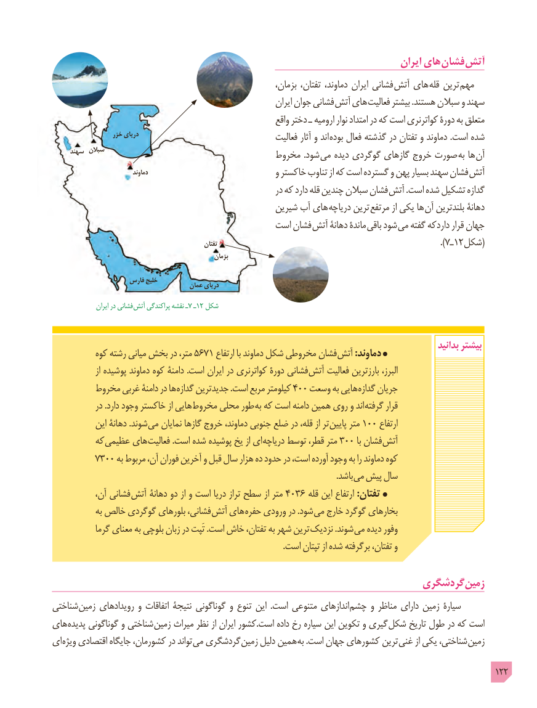

# PDF page 122

ایران های فشان آتش
                                                              بزمان، تفتان، دماوند، ایران فشانی  آتش های قله ترین مهم
                                                                  ایران جوان فشانی  آتش های فعالیت بیشتر .هستند سبالن و سهند
                                                               واقع دختر ـ ارومیه نوار امتداد در که است کواترنری دورۀ به متعلق
                   خزر دریای                                                            فعالیت آثار و اند بوده فعال گذشته در تفتان و دماوند .است شده
     سهند سبالن                                  مخروط .شود می دیده گوگردی گازهای خروج صورت به ها آن
                               دماوند                                 و خاکستر تناوب از که است گسترده و پهن بسیار سهند فشان آتش
                                                            در که دارد قله چندین سبالن فشان آتش .است شده تشکیل گدازه
                                                  شیرین آب های دریاچه ترین مرتفع از یکی ها آن بلندترین دهانۀ
                                          است فشان  آتش دهانۀ ماندۀ  باقی شود می گفته داردکه قرار جهان
                                                        تفتان                                                                    ).7ـ1 ٢شکل(
                                                         بزمان

                     فارس خلیج                                         عمان دریای
                  ایران در فشانی  آتش پراکندگی نقشه ـ7 ـ12 شکل

                                                                                                              بدانید بیشتر           کوه رشته میانی بخش در متر، 5671 ارتفاع با دماوند شکل مخروطی فشان آتش :دماوند
                 از پوشیده دماوند کوه دامنۀ .است ایران در کواترنری دورۀ فشانی آتش فعالیت بارزترین البرز،
         مخروط غربی دامنۀ در ها گدازه جدیدترین .است مربع کیلومتر 400 وسعت به هایی گدازه جریان
            در .دارد وجود خاکستر از هایی مخروط محلی طور به که است دامنه همین روی و اند گرفته قرار
            این دهانۀ .شوند می نمایان گازها خروج دماوند، جنوبی ضلع در قله، از تر پایین متر 100 ارتفاع
         که عظیمی های فعالیت .است شده پوشیده یخ از ای دریاچه توسط قطر، متر 300 با فشان آتش
         7300 به مربوط آن، فوران آخرین و قبل سال هزار ده حدود در است، آورده وجود به را دماوند کوه
                             . باشد می پیش سال
            آن، فشانی آتش دهانۀ دو از و است دریا تراز سطح از متر 4036 قله این ارتفاع :تفتان
             به خالص گوگردی بلورهای فشانی، آتش های حفره ورودی در .شود می خارج گوگرد بخارهای
            گرما معنای به بلوچی زبان در تَپت .است خاش تفتان، به شهر ترین نزدیک .شوند می دیده وفور
                                                                                                              .است تپتان از شده برگرفته تفتان، و

                                                             گردشگری زمین
شناختی زمین رویدادهای و اتفاقات نتیجۀ گوناگونی و تنوع این  .است متنوعی اندازهای چشم و مناظر دارای زمین سیارۀ
های پدیده گوناگونی و شناختی زمین میراث نظر از ایران کشور.است داده رخ سیاره این تکوین و گیری شکل تاریخ طول در که است
ای ویژه اقتصادی جایگاه کشورمان، در تواند می گردشگری زمین دلیل همین به .است جهان کشورهای ترین غنی از یکی شناختی، زمین

                                                                                                  122

