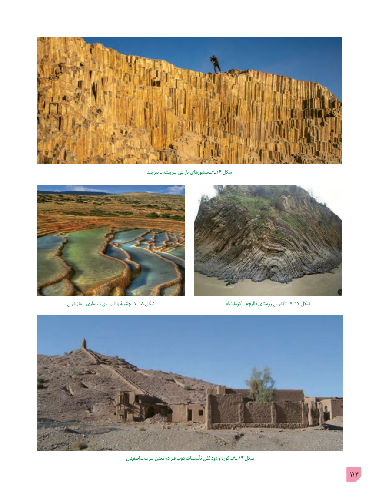

# PDF page 124

بیرجند ـ سربیشه بازالتی منشورهاي ـ7ـ16 شکل

مازندران ـ ساري سورت باداب چشمۀ ـ7ـ18 شکل                                     کرمانشاه ـ قالیچه روستای تاقدیس ـ7ـ17 شکل

                          اصفهان ـ  سرب معدن در فلز ذوب تأسیسات دودکش و کوره ـ7ـ 19 شکل
                                                                                        124

