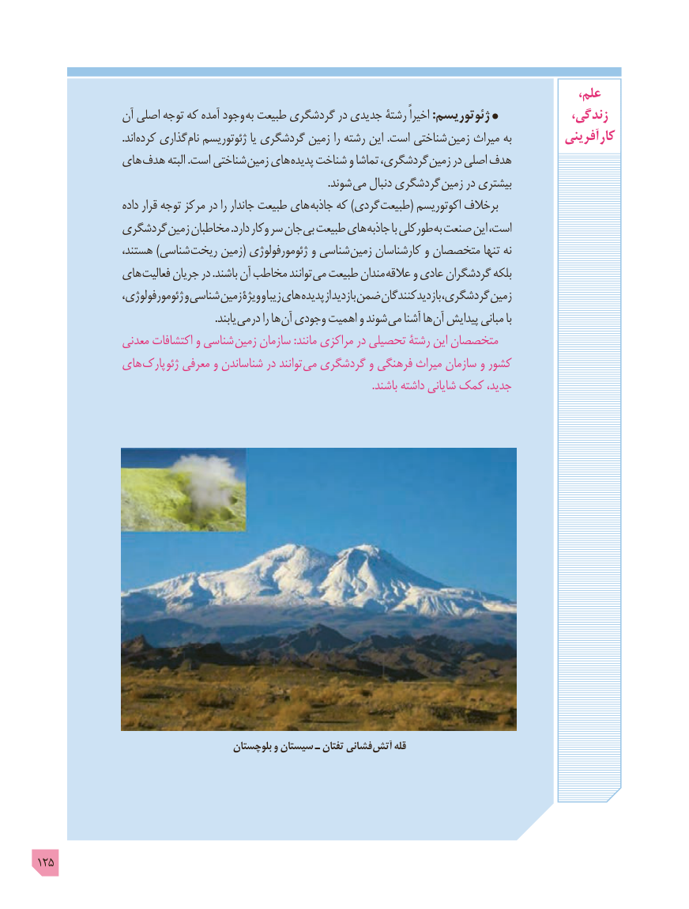

# PDF page 125

،علم
               آن اصلی توجه که آمده وجود به طبیعت گردشگری در جدیدی رشتۀ اخیراً :ژئوتوریسم             زندگی،
                                .اند کرده گذاری نام ژئوتوریسم یا گردشگری زمین را رشته این .است شناختی زمین میراث به         آفرینی  کار
             های هدف البته .است شناختی زمین های پدیده شناخت و تماشا گردشگری، زمین در اصلی هدف
                     . شوند می دنبال گردشگری زمین در بیشتری
                     داده قرار توجه مرکز در را جاندار طبیعت های جاذبه که )گردی طبیعت( اکوتوریسم برخالف
             گردشگری زمین مخاطبان .دارد وکار سر جان بی طبیعت های جاذبه با طورکلی به صنعت این است،
                 هستند، )شناسی ریخت زمین( ژئومورفولوژی و شناسی زمین کارشناسان و متخصصان تنها نه
             های فعالیت جریان در .باشند آن مخاطب توانند می طبیعت مندان عالقه و عادی گردشگران بلکه
                  ژئومورفولوژی، و شناسی زمین ویژۀ و زیبا های پدیده از بازدید ضمن بازدیدکنندگان گردشگری، زمین
              . یابند می در را ها آن وجودی اهمیت و شوند می آشنا ها آن پیدایش مبانی با
                معدنی اکتشافات و شناسی  زمین سازمان :مانند مراکزی در تحصیلی رشتۀ این متخصصان
             های پارک  ژئو معرفی و شناساندن در توانند  می گردشگری و فرهنگی میراث سازمان و کشور
                                                                                            .باشند داشته شایانی کمک جدید،

                                         بلوچستان و سیستان ـ تفتان فشانی آتش قله

125

