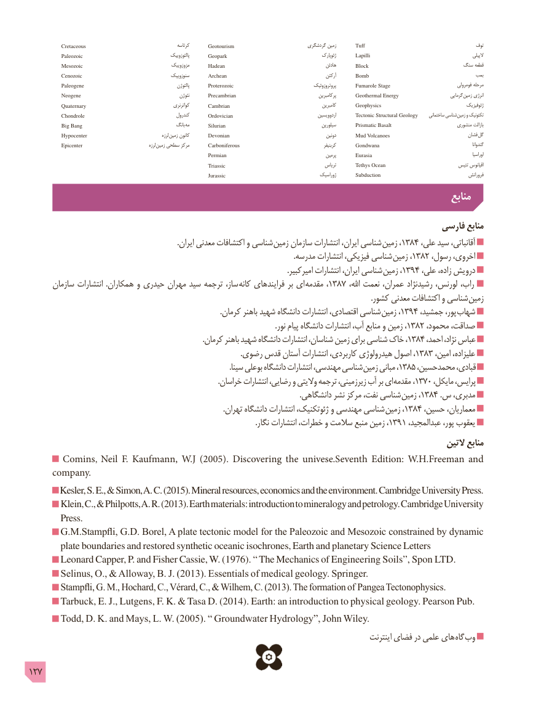

# PDF page 127

Cretaceous                                            کرتاسه       Geotourism                            گردشگری زمین        Tuff                                           توف
              Paleozoic                                              پالئوزوییک       Geopark                                              ژئوپارک         Lapilli                                                        الپیلی
            Mesozoic                                       مزوزوییک       Hadean                                                هادئن       Block                             سنگ قطعه
             Cenozoic                                      سنوزوییک       Archean                                               آرکئن      Bomb                                        بمب
             Paleogene                                                    پالئوژن        Proterozoic                                       پروتروزوئیک       Fumarole Stage                                فومرولی مرحله
            Neogene                                                 نئوژن       Precambrian                                          پرکامبرین       Geothermal Energy                        گرمایی  زمین انرژی
             Quaternary                                           کواترنری       Cambrian                                             کامبرین       Geophysics                                       ژئوفیزیک
             Chondrole                                         کندرول       Ordovician                                         اردوویسین        Tectonic Structural Geology     ساختمانی شناسی زمین و تکتونیک
            Big Bang                                          بانگ مه         Silurian                                              سیلورین        Prismatic Basalt                          منشوری بازالت
             Hypocenter                                            لرزه زمین کانون       Devonian                                               دونین      Mud Volcanoes                                فشان گل
              Epicenter                                       لرزه  زمین سطحی مرکز        Carboniferous                                               کربنیفر      Gondwana                                                         گندوانا
                                                                    Permian                                               پرمین        Eurasia                                                              اوراسیا
                                                                                   Triassic                                           تریاس        Tethys Ocean                             تتیس اقیانوس
                                                                                  Jurassic                                        ژوراسیک        Subduction                                        فرورانش
                                                                                                        منابع

                                                                                         فارسی منابع
   . ایران معدنی اکتشافات و شناسی زمین سازمان انتشارات ایران، شناسی  زمین ،1384 ،علی سید آقانباتی،
                                                                                                                                              .مدرسه انتشارات فیزیکی، شناسی  زمین ،1382 ،رسول اخروی،
                                                                                                                                           .امیرکبیر انتشارات ایران، شناسی  زمین ،1394 ،علی زاده، درویش
       سازمان انتشارات  .همکاران و حیدری مهران سید ترجمه ساز، کانه فرایندهای بر ای  مقدمه ،1387 ،اهلل نعمت عمران، رشیدنژاد لورنس، راب،
                                                                                                                                                                                        .کشور معدنی اکتشافات و شناسی  زمین
  . کرمان باهنر شهید دانشگاه انتشارات اقتصادی، شناسی زمین ،1394 ،پور،جمشید      شهاب
                                                                                                                                     .نور١٣٨٢پيام دانشگاه انتشارات آب، منابع و زمين ،         ،محمود صداقت،
                                                                                              .کرمان١٣٨٤باهنر شهيد دانشگاه انتشارات شناسان، زمين براى شناسى خاک ،         ،احمد نژاد، عباس
                                                                                                                  .رضوى١٣٨٣قدس آستان انتشارات کاربردى، هيدرولوژى اصول ،         ،امين عليزاده،
                                                                                                             .سينا بوعلى دانشگاه انتشارات مهندسى، شناسى زمين١٣٨٥مبانى ،         ،محمدحسين قبادى،
                                                                                                        .خراسان انتشارات رضايى، و واليتى ترجمه زيرزمينى، آب بر اى مقدمه ،١٣٧٠ ،مايکل پرايس،
                                                                                                                                                  .دانشگاهی نشر مرکز نفت، شناسی  زمین ،1384 .س مدبری،
                                                                                                         .تهران دانشگاه انتشارات ژئوتکنيک، و مهندسى شناسى  زمين١٣٨٤،         ،حسين معماريان،
                                                                                                                          .نگار انتشارات خطرات، و سالمت منبع زمین ،1391 ،عبدالمجید پور، یعقوب
                                                                                                                  التین منابع
       Comins, Neil F. Kaufmann, W.J (2005). Discovering the univese.Seventh Edition: W.H.Freeman and
     company.
        Kesler, S. E., & Simon, A. C. (2015). Mineral resources, economics and the environment. Cambridge University Press.
        Klein, C., & Philpotts, A. R. (2013). Earth materials: introduction to mineralogy and petrology. Cambridge University
         Press.
       G.M.Stampfli, G.D. Borel, A plate tectonic model for the Paleozoic and Mesozoic constrained by dynamic
        plate boundaries and restored synthetic oceanic isochrones, Earth and planetary Science Letters
       Leonard Capper, P. and Fisher Cassie, W. (1976). “ The Mechanics of Engineering Soils”, Spon LTD.
        Selinus, O., & Alloway, B. J. (2013). Essentials of medical geology. Springer.
        Stampfli, G. M., Hochard, C., Vérard, C., & Wilhem, C. (2013). The formation of  Pangea Tectonophysics.
       Tarbuck, E. J., Lutgens, F. K. & Tasa D. (2014). Earth: an introduction to physical geology. Pearson Pub.
       Todd, D. K. and Mays, L. W. (2005). “ Groundwater Hydrology”, John Wiley.
                                                                                                            اينترنت فضاى در علمى های  گاه وب

127

