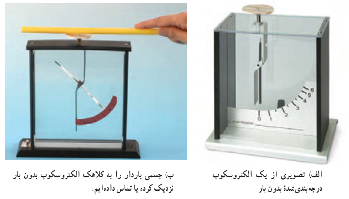
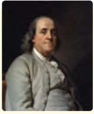

نوع باری که دو جسم مختلف بر اثر مالش پیدا می‌کنند، به جنس آنها بستگی دارد. همان‌طور که در کتاب علوم تجربی پایۀ هشتم خود دیدید باردار بودن یک جسم و نوع بار آن را می‌توانیم با الکتروسکوپ (برق‌نما) تعیین کنیم (شکل ۱ـ۵).

شکل ۱ـ۵ الف) تصویری از یک الکتروسکوپ درجه‌بندی‌شده بدون بار. ب) جسمی باردار را به کلاهک الکتروسکوپ بدون بار نزدیک کرده یا تماس داده‌ایم.

یکای بار الکتریکی در SI، کولُن (C) است. توجه کنید یک کولُن مقدار بار بزرگی است؛ مثلاً در یک آذرخش نوعی، باری از مرتبۀ $10\,\mathrm C$ به زمین منتقل می‌شود و از این رو، در این فصل غالباً با بارهایی از مرتبۀ میکروکولن ($\mu\mathrm C$) و نانو کولن (nC) سروکار داریم؛ به عنوان مثال، در مالش شانۀ پلاستیکی با موهای سر، بارهای منتقل شده از مرتبۀ نانو کولن (nC) است.

### پرسش ۱ـ۱

چرا وقتی روکش پلاستیکی را روی یک ظرف غذا می‌کشید و آن را در لبه‌های ظرف فشار می‌دهید، روکش در جای خود ثابت باقی می‌ماند؟

### ۱ـ۲ پایستگی و کوانتیده بودن بار الکتریکی

در یک اتم خنثی، تعداد الکترون‌ها برابر با تعداد پروتون‌های هسته است. بنابراین، جمع جبری همۀ بارها (بار خالص) دقیقاً برابر با صفر است. در تجربه‌هایی مانند مالش اجسام به یکدیگر، الکترون‌ها تولید نمی‌شوند و یا از بین نمی‌روند، بلکه صرفاً از جسمی به جسم دیگر منتقل می‌شوند.

اندازۀ بار منفی الکترون دقیقاً برابر با اندازۀ بار مثبت پروتون است. این مقدار را بار بنیادی (با نماد $e$) می‌گویند که برابر است با¹:

$$e=1.60217653\times10^{-19}\,\mathrm C\approx1.60\times10^{-19}\,\mathrm C$$

۱ـ اندازه‌گیری بار الکترون نخستین بار توسط رابرت میلیکان در سال ۱۹۱۳ میلادی انجام شد. این نتیجۀ اندازه‌گیری مربوط به سال ۲۰۰۵ میلادی است.

### بنیامین فرانکلین (۱۷۰۶–۱۷۹۰ م)

بنیامین فرانکلین دانشمند، نویسنده و سیاستمدار آمریکایی، در شهر بوستون به دنیا آمد و در شهر فیلادلفیا دیده از جهان فروبست. فرانکلین در حدود سال ۱۷۴۴ میلادی با مبحث الکتریسیته آشنا شد و عمدۀ کشفیات مهم و بزرگ خویش را در بین سال‌های ۱۷۳۷ تا ۱۷۵۱ به انجام رسانید و به شهرت علمی بی‌سابقه‌ای رسید. جالب است که او برخلاف سایر دانشمندان بزرگ، پس از چهل‌سالگی کارهای علمی اساسی خود را آغاز کرد. مهم‌ترین اثر فرانکلین، کتاب «در باب الکتریسیته» است که بسیاری آن را با کتاب «اصول ریاضیات» اسحاق نیوتون مقایسه کرده‌اند. فرانکلین در این کتاب شالوده و بنیاد اصول علم الکتریسیته را بر مبنای تجربیات و مشاهدات علمی خود تشریح کرده است. در واقع تجربیات متعدد و مهم فرانکلین آغازگر دوره‌ای جدید در مبحث الکتریسیته بوده است و بسیاری از واژگانی که ما امروزه در الکتریسیته به کار می‌گیریم نخستین بار توسط فرانکلین به کار برده شده است. توانایی و مهارت فرانکلین در انجام آزمایش و بیان واضح وی از مفاهیم فیزیکی و بالاخره کشفیات مهم او موجب ارج و قرب علوم تجربی در قرن هجدهم شد.
