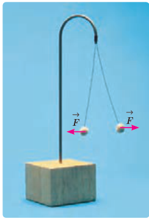
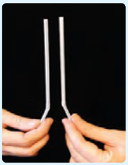
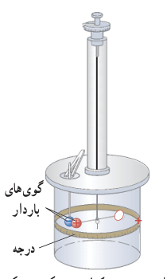

### ۱ـ۳ قانون کولن

همان‌طور که می‌دانیم نیروی الکتریکی که دو جسم باردار بر هم وارد می‌کنند می‌تواند جاذبه یا دافعه باشد. اگر بارهای الکتریکی دو جسم همنام باشند، این نیرو دافعه است (شکل ۱ـ۶). و اگر ناهمنام باشند، این نیرو جاذبه است.

شکل ۱ـ۶ گوی‌های باردار همنام یکدیگر را با نیرویی هم‌اندازه دفع کرده‌اند.

### فعالیت ۱ـ۱ (کار در کلاس)

مطابق شکل، دو نی پلاستیکی را از نزدیکی یک انتهای آنها خم کنید و پس از مالش دادن با پارچه‌ای پشمی نزدیک یکدیگر قرار دهید. اگر نی‌ها به خوبی باردار شده باشند، نیروی دافعۀ آنها را می‌توانید به وضوح بر روی انگشتان خود حس کنید.

نیروی الکتریکی بین دو جسم باردار، به چه عامل‌هایی بستگی دارد و اندازۀ این نیروها را از چه رابطه‌ای می‌توان محاسبه کرد؟ شارل آگوستین کولن، دانشمند فرانسوی برای نخستین بار با انجام آزمایش‌های ساده و هوشمندانه‌ای توانست عامل‌های مؤثر بر نیروی الکتریکی بین دو ذرۀ باردار را که اصطلاحاً بار نقطه‌ای خوانده می‌شود، شناسایی کند. نتیجۀ آزمایش‌های او امروزه به نام قانون کولن خوانده می‌شود. شکل ۱ـ۷ طرحی از آزمایش کولن را نشان می‌دهد.

قانون کولن بیان می‌دارد: اندازۀ نیروی الکتریکی (الکترواستاتیکی) بین دو بار نقطه‌ای¹ که در راستای خط واصل آنها اثر می‌کند، با حاصل‌ضرب بزرگی آنها متناسب است و با مربع فاصلۀ بین آنها نسبت وارون دارد. بنابراین، اندازۀ این نیرو برابر است با:

$$F=k\frac{|q_1||q_2|}{r^2}\tag{1-2}$$

شکل ۱ـ۷ ترازوی پیچشی کولن. در یک سر یک میلۀ نارسانای سبک افقی یک گوی باردار مثبت کوچک و در سر دیگر آن، یک قرص قرار دارد و میله از وسط توسط یک رشتۀ سیم کشسان و نازک آویخته شده است. یک گوی با بار منفی از حفره‌ای به داخل استوانۀ شیشه‌ای برده می‌شود. درجه‌هایی بر سطح استوانه حک شده است که زاویۀ چرخش میله را نشان می‌دهد. نیروی مؤثر بین این دو بار با اندازه‌گیری زاویۀ چرخش تا رسیدن به حالت تعادل به‌دست می‌آید.

۱ـ در این بخش با نیروهای بین ذره‌های باردار (بارهای نقطه‌ای) سروکار داریم. البته اگر فاصلۀ یک جسم باردار با جسم باردار دیگر چنان زیاد باشد که بتوان از ابعاد هریک از دو جسم در مقایسه با فاصلۀ بین آنها چشم‌پوشی کرد، می‌توان دو جسم را به صورت ذره‌های باردار در نظر گرفت.
