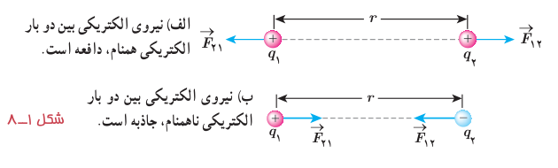
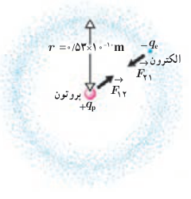

در آن $q_1$ و $q_2$ بارهای الکتریکی دو بار نقطه‌ای برحسب کولن (C)، $r$ فاصلۀ بین دو بار برحسب متر (m)، و $F$ بزرگی نیروی الکتریکی وارد بر هر بار برحسب نیوتون (N) است. در این رابطه $k$ ثابت الکتروستاتیکی یا ثابت کولن نام دارد و برابر است با¹:

$$k=8.98755179\times10^9\ \mathrm{N.m^2/C^2}\approx9.0\times10^9\ \mathrm{N.m^2/C^2}$$

در شکل ۱ـ۸، $\vec F_{12}$ نیرویی است که بار نقطه‌ای $q_1$ به بار نقطه‌ای $q_2$ وارد می‌کند و $\vec F_{21}$ نیرویی است که بار نقطه‌ای $q_2$ به بار نقطه‌ای $q_1$ وارد می‌کند. این دو نیروی الکتریکی (بنا به قانون سوم نیوتون) هم‌اندازه، هم‌راستا، و در خلاف جهت همدیگرند. به عبارتی:

$$\vec F_{12}=-\vec F_{21}\Rightarrow F_{12}=F_{21}=F$$

### مثال ۱ـ۲

الف) در مدل بور برای اتم هیدروژن، فاصلۀ الکترون از پروتون هسته در حالت پایه $5.3\times10^{-11}\ \mathrm m$ است (شکل را ببینید). اندازۀ نیروی الکتریکی که پروتون به الکترون وارد می‌کند را محاسبه کنید.

ب) در هستۀ اتم هلیم دو پروتون به فاصلۀ تقریبی $r=2.4\times10^{-15}\ \mathrm m$ از هم قرار دارند. اندازۀ نیرویی که پروتون‌ها بر هم وارد می‌کنند را محاسبه کنید.

**پاسخ:**

الف) با استفاده از قانون کولن برای بزرگی نیروی الکتریکی بین دو ذرۀ باردار داریم:

$$F=k\frac{|q_1||q_2|}{r^2}=k\frac{|q_e||q_p|}{r^2}=(9.0\times10^9\ \mathrm{N.m^2/C^2})\frac{(1.60\times10^{-19}\ \mathrm C)^2}{(5.3\times10^{-11}\ \mathrm m)^2}=8.2\times10^{-8}\ \mathrm N$$

ب) با استفاده از قانون کولن داریم:

$$F=k\frac{|q_p||q_p|}{r^2}=(9.0\times10^9\ \mathrm{N.m^2/C^2})\frac{(1.60\times10^{-19}\ \mathrm C)^2}{(2.4\times10^{-15}\ \mathrm m)^2}=40\ \mathrm N$$

که این به مراتب بزرگ‌تر از نیروی محاسبه‌شده در قسمت الف است. این نیروی بزرگ، از جنس دافعه است. بنابراین، هسته اتم باید فرو بپاشد. از اینجا نتیجه می‌گیریم که باید نیروی دیگری وجود داشته باشد که مانع فروپاشی هسته شود. به این نیرو، نیروی هسته‌ای گفته می‌شود.

**شارل آگوستین کولن (۱۸۰۶–۱۷۳۶ م)**

شارل آگوستین کولن در فرانسه به دنیا آمد. او در دانشگاه مباحث متنوعی از قبیل فلسفه، ریاضیات، نجوم و شیمی را آموخت، و در طی دوازده سال پس از فارغ‌التحصیلی شغل‌های متنوعی در شاخه‌های مختلف مهندسی داشت و مدتی را نیز خارج از فرانسه گذراند. کولن پس از بازگشت به پاریس در سال ۱۷۸۵ میلادی تقریباً هم‌زمان با بنجامین فرانکلین آزمایش معروف خود را در مورد اینکه نیروی بین دو بار ذره‌ای با مربع فاصلۀ بین آنها نسبت وارون دارد، به چاپ رساند. نتیجۀ این آزمایش که به قانون کولن معروف شده است از هر آزمون و تجربه‌ای سربلند بیرون آمده است و تاکنون هیچ استثنایی برای آن یافت نشده است. کولن معتقد بود چنین قانونی برای قطب‌های مغناطیسی نیز برقرار است، گرچه هیچ‌وقت نتوانست به چنین رابطه‌ای دست یابد. نام کولن یکی از ۷۲ نامی است که روی برج ایفل ثبت شده است.

ثابت کولن ($k$) را می‌توان برحسب یک ضریب ثابت دیگر به نام ضریب گذردهی الکتریکی خلأ ($\varepsilon_0$) نیز نوشت:

$$k=\frac{1}{4\pi\varepsilon_0},\qquad \varepsilon_0=8.85\times10^{-12}\ \mathrm{C^2/N.m^2}$$

۱ـ به ذهن سپردن این اعداد لازم نیست.
