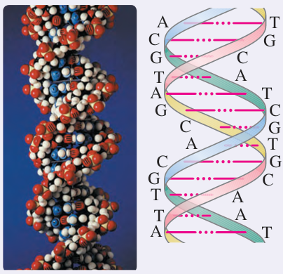
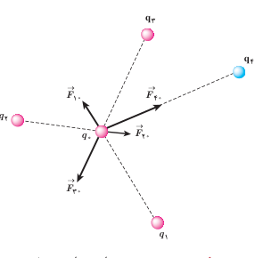

### خوب است بدانید

تمامی اجسام به علت جرمشان بر یکدیگر نیروی گرانشی نیز وارد می‌کنند که همواره از نوع جاذبه است. بزرگی این نیرو برای الکترون و پروتون اتم هیدروژن از مرتبه $10^{-47}\ \mathrm N$ است. بنابراین، در حدود $10^{40}$ بار کوچک‌تر از نیروی الکتریکی بین این دو ذره است و این نشان می‌دهد نیروی گرانشی به مراتب ضعیف‌تر از نیروی الکتریکی است.

### خوب است بدانید: DNA

اطلاعات ژنتیکی در مولکول‌های خاصی به نام دِنا (DNA) وجود دارد. در واقع دنا دارای اطلاعات و دستورهایی برای تعیین و ایجاد صفات ارثی ما و همۀ جانداران است. در مولکول‌های دنا چهار نوع باز به نام‌های آدنین (A)، سیتوزین (C)، گوانین (G) و تیمین (T) وجود دارد. دنا مولکولی دورشته‌ای است که به صورت مارپیچ دوگانه پیچیده شده است. همان‌طور که در شکل نشان داده شده است این دو رشته توسط نیروهای الکتریکی به یکدیگر پیوند خورده‌اند؛ مثلاً در شکل می‌بینیم که همواره آدنین و تیمین در دو طرف رشته و مقابل هم قرار دارند. به همین ترتیب G و C نیز در دو طرف رشته و مقابل هم قرار دارند.

بارهای مثبت در یک طرف رشته و بارهای منفی در طرف دیگر، دو رشته را به هم جذب می‌کنند. این جاذبه آن‌قدر هست که رشته‌ها از هم نگسلد، اما به حد کافی ضعیف نیز هست تا در فرایند رونویسی از هم گسیخته گردد.

**برآیند نیروهای الکتریکی:** اگر به جای دو ذرۀ باردار، تعدادی بار نقطه‌ای داشته باشیم، نیروی الکتریکی وارد بر هر ذره، برآیند نیروهایی است که هر یک از ذره‌های دیگر به‌تنهایی بر آن ذره وارد می‌کند.

فرض کنید $n$ ذرۀ باردار داشته باشیم که در نزدیکی بار نقطه‌ای $q_0$ قرار دارند. آن‌گاه نیروی خالص (برآیند) وارد بر بار نقطه‌ای $q_0$ با جمع برداری زیر داده می‌شود:

$$\vec F_{T0}=\vec F_{10}+\vec F_{20}+\cdots+\vec F_{n0}$$

شکل ۱ـ۹ نیروی وارد بر بار $q_0$ از سوی چهار بار دیگر را نشان می‌دهد. در این کتاب، مثال‌هایی را بررسی می‌کنیم که در آنها نیروهای الکتریکی وارد بر یک ذرۀ باردار در یک راستا قرار دارند یا عمود بر یکدیگرند¹.

۱ـ بررسی حالت‌هایی که نیروها هم‌راستا و یا عمود بر هم نیستند، خارج از برنامۀ درسی این کتاب بوده و نباید مورد ارزشیابی قرار گیرد.
