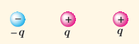
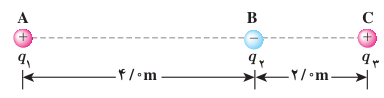
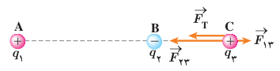

### پرسش ۱ـ۲

سه ذرۀ باردار مانند شکل روبه‌رو، روی یک خط راست قرار دارند و فاصلۀ بارهای سمت راست و چپ از بار میانی برابر است. الف) جهت نیروی الکتریکی خالص وارد بر بار الکتریکی میانی را تعیین کنید. ب) اگر ذرۀ سمت راست به جای $q$، بار $-q$ داشته باشد، جهت نیروی الکتریکی خالص وارد بر بار میانی چگونه خواهد بود؟

### مثال ۱ـ۳

سه ذره با بارهای $q_1=+2.5\ \mu\mathrm C$، $q_2=-1.0\ \mu\mathrm C$ و $q_3=+4.0\ \mu\mathrm C$ در نقطه‌های A، B و C مطابق شکل روبه‌رو ثابت شده‌اند. نیروی الکتریکی خالص وارد بر بار $q_3$ را محاسبه کنید.

**پاسخ:** نیروی الکتریکی خالصی که بر بار $q_3$ وارد می‌شود، برآیند دو نیرویی است که از طرف بارهای $q_1$ و $q_2$ بر آن وارد می‌شوند. برای محاسبۀ این نیرو، نیرویی را که هر یک از بارهای $q_1$ و $q_2$ در نبود دیگری، بر بار $q_3$ وارد می‌کند، محاسبه می‌کنیم. نیروی الکتریکی وارد بر $q_3$، برآیند این دو نیرو است.

فاصله بین بارهای $q_1$ و $q_3$ را با $r_{13}$ و فاصله بین بارهای $q_2$ و $q_3$ را با $r_{23}$ نشان می‌دهیم. با استفاده از رابطۀ ۱ـ۲ داریم:

$$F_{13}=k\frac{|q_1||q_3|}{r_{13}^2}=(9.0\times10^9\ \mathrm{N.m^2/C^2})\frac{(2.5\times10^{-6}\ \mathrm C)(4.0\times10^{-6}\ \mathrm C)}{(6.0\ \mathrm m)^2}=2.5\times10^{-3}\ \mathrm N$$

$$F_{23}=k\frac{|q_2||q_3|}{r_{23}^2}=(9.0\times10^9\ \mathrm{N.m^2/C^2})\frac{(1.0\times10^{-6}\ \mathrm C)(4.0\times10^{-6}\ \mathrm C)}{(2.0\ \mathrm m)^2}=9.0\times10^{-3}\ \mathrm N$$

نیرویی که بار $q_1$ بر بار $q_3$ وارد می‌کند، دافعه و نیرویی که بار $q_2$ بر بار $q_3$ وارد می‌کند جاذبه است. مطابق شکل، نیروهای $\vec F_{13}$ و $\vec F_{23}$ در جهت‌های مخالف یکدیگرند و برآیند آنها برابر است با:

$$\vec F_T=\vec F_{23}+\vec F_{13}$$

بنابراین، اندازۀ نیروی برآیند برابر با تفاضل اندازۀ آنهاست:

$$F_T=F_{23}-F_{13}=6.5\times10^{-3}\ \mathrm N$$

و جهت آن در جهت نیروی بزرگ‌تر ($\vec F_{23}$)، یعنی از سمت راست به طرف چپ است. اگر محور $x$ را روی خط واصل سه بار و جهت مثبت آن را به سمت راست درنظر بگیریم و بردار یکۀ محور $x$ را، $\hat i$ بنامیم، داریم:

$$\vec F_T=(-6.5\times10^{-3}\ \mathrm N)\hat i$$
