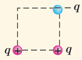
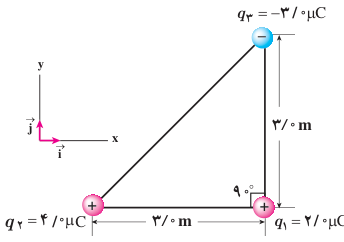
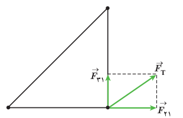

### تمرین ۱ـ۲

در مثال ۱ـ۳، نیروی خالص وارد بر بار $q_2$ را به‌دست آورید.

### پرسش ۱ـ۳

سه ذرۀ باردار مطابق شکل روبه‌رو، در سه گوشۀ یک مربع قرار دارند. الف) جهت نیروی الکتریکی خالص وارد بر بار سمت راست پایینی را تعیین کنید. ب) اگر ذرۀ سمت چپ پایینی به جای $q$، بار $-q$ داشته باشد، جهت نیروی الکتریکی خالص وارد بر بار سمت راست پایینی چگونه خواهد بود؟

### مثال ۱ـ۴

سه ذرۀ باردار مطابق شکل روبه‌رو در سه رأس مثلث قائم‌الزاویه‌ای ثابت شده‌اند. نیروی الکتریکی خالص وارد بر ذرۀ واقع در رأس قائمه را به‌دست آورده و اندازۀ این نیرو را محاسبه کنید.

**پاسخ:** نیروی الکتریکی بین بارهای $q_1$ و $q_2$ دافعه و نیروی بین بارهای $q_1$ و $q_3$، جاذبه است. با استفاده از رابطۀ ۱ـ۲ داریم:

$$F_{21}=k\frac{|q_2||q_1|}{r_{21}^2}=(9.0\times10^9\ \mathrm{N.m^2/C^2})\frac{(4.0\times10^{-6}\ \mathrm C)(2.0\times10^{-6}\ \mathrm C)}{(3.0\ \mathrm m)^2}=8.0\times10^{-3}\ \mathrm N$$

با توجه به دستگاه مختصات داده شده، $\vec F_{21}$ در جهت مثبت محور $x$ است. بنابراین، $\vec F_{21}=(8.0\times10^{-3}\ \mathrm N)\hat i$ می‌شود. به همین ترتیب، برای نیروی بین بارهای $q_3$ و $q_1$ داریم:

$$F_{31}=k\frac{|q_3||q_1|}{r_{31}^2}=(9.0\times10^9\ \mathrm{N.m^2/C^2})\frac{(3.0\times10^{-6}\ \mathrm C)(2.0\times10^{-6}\ \mathrm C)}{(3.0\ \mathrm m)^2}=6.0\times10^{-3}\ \mathrm N$$

با توجه به دستگاه مختصات داده شده، $\vec F_{31}$ در جهت مثبت محور $y$ است. بنابراین، $\vec F_{31}=(6.0\times10^{-3}\ \mathrm N)\hat j$ می‌شود. پس برآیند نیروهای الکتریکی وارد بر بار $q_1$ برابر است با:

$$\vec F_T=\vec F_{21}+\vec F_{31}=(8.0\times10^{-3}\ \mathrm N)\hat i+(6.0\times10^{-3}\ \mathrm N)\hat j$$

و بزرگی آن با استفاده از رابطۀ فیثاغورس، چنین به‌دست می‌آید:

$$F_T=\sqrt{F_{21}^2+F_{31}^2}=\sqrt{(8.0\times10^{-3}\ \mathrm N)^2+(6.0\times10^{-3}\ \mathrm N)^2}=1.0\times10^{-2}\ \mathrm N$$

