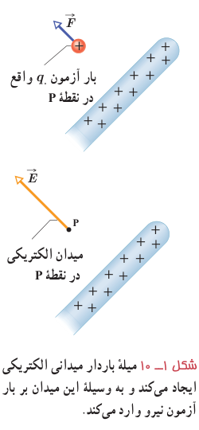
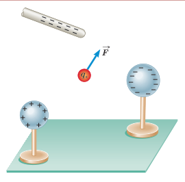

### تمرین ۱ـ۳

در مثال ۱ـ۴: الف) اگر علامت بار $q_3$ تغییر کند جهت نیروی برآیند وارد بر بار $q_1$ چگونه خواهد شد؟

ب) اگر علامت بار $q_2$ تغییر کند، جهت نیروی برآیند وارد بر بار $q_1$ چگونه خواهد شد؟

پ) آیا اندازۀ نیروی برآیند وارد بر بار $q_1$ در قسمت‌های الف و ب با مقدار به‌دست آمده در مثال ۱ـ۴ متفاوت است؟

## ۱ـ۴ میدان الکتریکی

در بخش ۱ـ۱ دیدیم که دو بار الکتریکی $q_1$ و $q_2$ که در فاصله‌ای از یکدیگر قرار دارند، برهم نیروی الکتریکی وارد می‌کنند. ولی این پرسش مطرح می‌شود که بارهای $q_1$ و $q_2$ چطور حضور یکدیگر را حس می‌کنند؟ به‌عبارت دیگر، این دو بار الکتریکی که در تماس با هم نیستند، چگونه می‌توانند بر یکدیگر نیرو وارد کنند؟ در فیزیک پاسخ این پرسش این‌گونه است که بار $q_1$ خاصیتی در فضای پیرامون خود ایجاد می‌کند که به آن اصطلاحاً **میدان الکتریکی** بار $q_1$ گفته می‌شود. وقتی بار $q_2$ را در نقطه‌ای از فضای پیرامون بار $q_1$ قرار دهیم، تحت تأثیر میدان الکتریکی‌ای قرار می‌گیرد که بار $q_1$ پیش‌تر در آن نقطه ایجاد کرده است. بنابراین، بار $q_1$، نه با تماس با بار $q_2$ بلکه به‌وسیلۀ میدان الکتریکی خودش بر بار $q_2$ نیرو وارد می‌کند.

میدان الکتریکی در هر نقطه از فضای اطراف یک جسم باردار الکتریکی به صورت زیر تعیین می‌شود: نخست بار کوچک و مثبت $q_0$ موسوم به **بار آزمون**¹ را در آن نقطه قرار می‌دهیم و سپس نیروی الکتریکی $\vec F$ وارد بر آن را اندازه می‌گیریم. آن‌گاه میدان الکتریکی $\vec E$ ناشی از جسم باردار در آن نقطه به‌صورت زیر تعریف می‌شود:

$$\vec E=\frac{\vec F}{q_0}\qquad (۱-۳)$$

بنا به تعریف میدان الکتریکی (رابطۀ ۱ـ۳)، میدان الکتریکی کمیتی برداری است که اندازۀ آن برابر $E=F/q_0$ و جهت آن همان جهت نیروی وارد بر بار آزمون است؛ مثلاً شکل ۱ـ۱۰ قسمتی از میلۀ بارداری را نشان می‌دهد که بر بار آزمون واقع در نقطۀ P نیرو وارد می‌کند. پس میدان در این نقطه، براساس این نیرو تعریف می‌شود. در رابطۀ ۱ـ۳ یکای میدان الکتریکی ($\vec E$)، نیوتون بر کولن (N/C) است.

### مثال ۱ـ۵

بار آزمون نشان داده شده در شکل $q_0=+3.0\times10^{-8}\ \mathrm C$ است و از سوی دو گوی و یک میلۀ باردار نیرویی برابر با $F=6.0\times10^{-5}\ \mathrm N$ در جهت نشان داده شده بر آن وارد می‌شود.

الف) میدان الکتریکی در محل بار آزمون را تعیین کنید.

ب) اگر بار $+12\times10^{-8}\ \mathrm C$ را به جای $q_0$ قرار دهیم، چه نیرویی به آن وارد می‌شود؟

۱ـ بار آزمون باید آن‌قدر کوچک باشد که توزیع بار جسم را برهم نزند.
