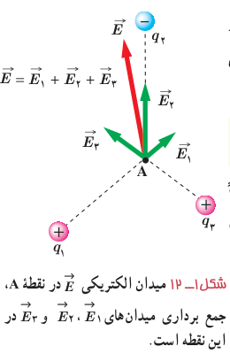
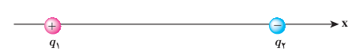
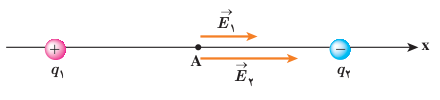

### تمرین ۱ـ۴

طبق مدل بور برای اتم هیدروژن، در حالت پایه فاصلۀ الکترون از پروتون هسته برابر با $5.3\times10^{-11}\ \mathrm m$ است.

الف) اندازۀ میدان الکتریکی ناشی از پروتون هسته را در این فاصله تعیین کنید.

ب) در چه فاصله‌ای از پروتون هسته، بزرگی میدان الکتریکی برابر با بزرگی میدان الکتریکی حاصل از مولد وان‌دوگراف مثال پیش در فاصلۀ $1.0\ \mathrm m$ از مرکز کلاهک آن است؟

**برآیند میدان‌های الکتریکی:** برای یافتن میدان الکتریکی خالص حاصل از چند ذرۀ باردار در نقطه‌ای از فضا باید نخست میدان الکتریکی ناشی از هر ذره را در آن نقطه به دست آورد و سپس این میدان‌ها را به صورت برداری با یکدیگر جمع کرد:

$$\vec E=\vec E_1+\vec E_2+\cdots\qquad (۱-۵)$$

مثلاً شکل ۱ـ۱۲ میدان الکتریکی خالص در نقطۀ A را نشان می‌دهد. در این کتاب، صرفاً مثال‌هایی را بررسی می‌کنیم که در آنها میدان‌های الکتریکی در یک نقطه، در یک راستا قرار دارند یا عمود بر یکدیگرند¹.

### مثال ۱ـ۷

مطابق شکل، دو ذره با بارهای $q_1=4.0\ \mu\mathrm C$ و $q_2=-6.0\ \mu\mathrm C$ در فاصلۀ $8.0\ \mathrm m$ از یکدیگر ثابت شده‌اند. اندازۀ میدان الکتریکی خالص را در نقطه‌های زیر به‌دست آورید:

الف) در وسط خط واصل دو ذره،

ب) در نقطه‌ای روی خط واصل دو ذره به فاصلۀ $8.0\ \mathrm m$ از بار $q_1$ و $16\ \mathrm m$ از بار $q_2$.

**پاسخ:** در غیاب هر یک از دو ذره، میدان حاصل از بار دیگر را محاسبه می‌کنیم. میدان حاصل از مجموعۀ دو بار، برآیند این دو میدان خواهد بود.

الف) در شکل اگر بار آزمون را در نقطۀ A واقع در وسط خط واصل دو ذره قرار دهیم، بار $q_1$ آن را دفع و بار $q_2$ آن را جذب می‌کند. بنابراین، همان‌طور که شکل نشان می‌دهد، $\vec E_1$ و $\vec E_2$ در نقطۀ A هم‌جهت و به سوی بار $q_2$ (در سوی مثبت محور $x$) هستند. میدان خالص در نقطۀ A، برآیند میدان‌های $\vec E_1$ و $\vec E_2$ است:

$$\vec E_A=\vec E_1+\vec E_2=E_1\hat i+E_2\hat i$$

۱ـ بررسی حالت‌هایی که میدان‌ها هم‌راستا و یا عمود برهم نیستند، خارج از برنامۀ درسی این کتاب بوده و نباید مورد ارزشیابی قرار گیرد.
