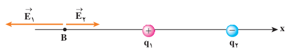
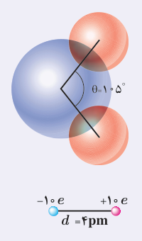

مقادیر $E_1$ و $E_2$ را با استفاده از رابطۀ ۱ـ۴ به‌دست می‌آوریم:

$$E_1=k\frac{|q_1|}{r_1^2}=(9.0\times10^9\ \mathrm{N.m^2/C^2})\frac{4.0\times10^{-6}\ \mathrm C}{(4.0\ \mathrm m)^2}=2.25\times10^3\ \mathrm{N/C}\approx2.3\times10^3\ \mathrm{N/C}$$

$$E_2=k\frac{|q_2|}{r_2^2}=(9.0\times10^9\ \mathrm{N.m^2/C^2})\frac{6.0\times10^{-6}\ \mathrm C}{(4.0\ \mathrm m)^2}=3.375\times10^3\ \mathrm{N/C}\approx3.4\times10^3\ \mathrm{N/C}$$

بنابراین:

$$\vec E_A=(2.3\times10^3\ \mathrm{N/C})\hat i+(3.4\times10^3\ \mathrm{N/C})\hat i=(5.7\times10^3\ \mathrm{N/C})\hat i$$

ب) اکنون اگر بار آزمون را در نقطۀ B قرار دهیم شکل میدان‌های الکتریکی به‌صورت زیر در می‌آید:

میدان خالص در نقطۀ B، برآیند میدان‌های $\vec E_1$ و $\vec E_2$ است:

$$\vec E_B=\vec E_1+\vec E_2=-E_1\hat i+E_2\hat i$$

که در آن $E_1$ و $E_2$ برابرند با:

$$E_1=k\frac{|q_1|}{r_1^2}=(9.0\times10^9\ \mathrm{N.m^2/C^2})\frac{4.0\times10^{-6}\ \mathrm C}{(8.0\ \mathrm m)^2}=5.625\times10^2\ \mathrm{N/C}\approx5.6\times10^2\ \mathrm{N/C}$$

$$E_2=k\frac{|q_2|}{r_2^2}=(9.0\times10^9\ \mathrm{N.m^2/C^2})\frac{6.0\times10^{-6}\ \mathrm C}{(16\ \mathrm m)^2}=2.109\times10^2\ \mathrm{N/C}\approx2.1\times10^2\ \mathrm{N/C}$$

بنابراین:

$$\vec E_B\approx(-5.6\times10^2\ \mathrm{N/C})\hat i+(2.1\times10^2\ \mathrm{N/C})\hat i=(-3.5\times10^2\ \mathrm{N/C})\hat i$$

### خوب است بدانید

**دوقطبی الکتریکی** آرایشی از بارهای الکتریکی است که در آن دو ذره با بزرگی بار $q$ی یکسان و علامت مخالف در فاصلۀ $d$ از هم روی محوری که به آن محور دوقطبی گفته می‌شود قرار گرفته‌اند. مولکول آب ($\mathrm{H_2O}$) از دو اتم هیدروژن و یک اتم اکسیژن ساخته شده است. اتم اکسیژن ۱۰ الکترون موجود در مولکول را به سمت خود می‌کشد و بدین ترتیب اتم‌های هیدروژن بار مثبت و خودش بار منفی پیدا می‌کند. این سه اتم مطابق شکل به گونه‌ای قرار گرفته‌اند که خطوط وصل کنندۀ مراکز اتم‌های هیدروژن به مرکز اتم اکسیژن، زاویۀ ۱۰۵° با یکدیگر می‌سازند. اندازه‌گیری و محاسبه نشان می‌دهد میدان الکتریکی ایجاد شده به‌وسیلۀ مولکول آب به‌گونه‌ای است که می‌توان فرض کرد کل بار $+10e$ پروتون‌های مولکول و کل بار $-10e$ الکترون‌های مولکول به شکل دو بار نقطه‌ای و در فاصلۀ $4\ \mathrm{pm}$ از هم قرار گرفته‌اند و همچون یک دو قطبی الکتریکی ایجاد میدان الکتریکی می‌کنند. بررسی میدان الکتریکی دوقطبی و نیز اثر میدان الکتریکی خارجی بر دوقطبی، اهمیت زیادی در شناخت رفتار الکتریکی مولکول‌های قطبی (مانند مولکول آب) در میدان‌های الکتریکی دارد.

