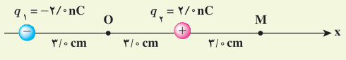
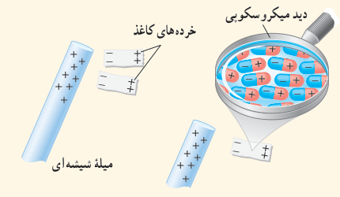
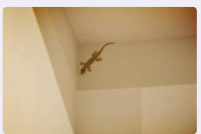

### تمرین ۱ـ۵

شکل زیر، آرایشی از دو بار الکتریکی هم‌اندازه و غیرهمنام (دوقطبی الکتریکی) را نشان می‌دهد که در آن فاصلۀ دو بار از هم $6.0\ \mathrm{cm}$ است. میدان الکتریکی خالص را در نقطه‌های O و M به‌دست آورید.

### پرسش ۱ـ۴

با توجه به شکل زیر توضیح دهید چرا یک میلۀ باردار، خرده‌های کاغذ را می‌رباید؟

### خوب است بدانید: نیروی وان‌دروالس و چسبیدن مارمولک‌ها به دیوار

نیروی وان‌دروالس برای توصیف نیروی جاذبۀ الکتریکی بین مولکول‌ها استفاده می‌شود. دلیل این نام‌گذاری این است که وان‌دروالس در سال ۱۸۷۳ نخستین پیشنهاد را برای نیروهای الکتریکی بین ذره‌های سازندۀ گاز به منظور توصیف برخی از ویژگی‌های گازهای غیرآرمانی و مایعات ارائه کرد. منشأ نیروی وان‌دروالس برهم‌کنش الکتریکی بین دوقطبی‌های الکتریکی است. براساس نیروی وان دروالس می‌توان بسیاری از چسبندگی‌ها از جمله چسبندگی پای مارمولک روی دیوار را توضیح داد.

پای مارمولک تعداد بی‌شماری مو موسوم به سِتا دارد که هر مو صدها برجستگی یا سرمنشأیی دارد که به کاردک معروف‌اند. وقتی مارمولک پای خود را بر دیوار می‌فشارد تمام این کاردک‌ها توسط نیروی وان دروالس به دیوار می‌چسبند. در این حالت، دوقطبی‌های موجود در سطح کاردک‌ها و سطح دیوار، یکدیگر را جذب می‌کنند. گرچه نیروی وان دروالس ضعیف است، اما مجموع این نیروهای بی‌شمار می‌تواند مارمولک را بر سطح دیوار نگه دارد.

۱ـ Van der Waals
