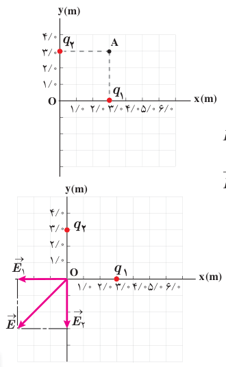
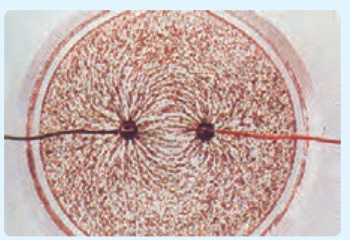

### مثال ۱ـ۸

شکل روبه‌رو، دو بار نقطه‌ای $q_1$ و $q_2$ را در صفحۀ xy نشان می‌دهد. میدان الکتریکی خالص را در نقطۀ O (مبدأ مختصات) تعیین کنید. ($q_1=q_2=5.0\ \mu\mathrm C$)

**پاسخ:** در نقطۀ O میدان‌های الکتریکی مانند شکل زیر می‌شوند؛ چون بارها با هم برابر و فاصلۀ آنها تا نقطۀ O نیز یکسان است، پس اندازۀ میدان‌ها در این نقطه با هم برابرند:

$$E_1=E_2=k\frac{|q|}{r^2}=(9.0\times10^9\ \mathrm{N.m^2/C^2})\frac{5.0\times10^{-6}\ \mathrm C}{(3.0\ \mathrm m)^2}=5.0\times10^3\ \mathrm{N/C}$$

$$\vec E_1=(-5.0\times10^3\ \mathrm{N/C})\hat i\quad و\quad \vec E_2=(-5.0\times10^3\ \mathrm{N/C})\hat j$$

در نتیجه میدان الکتریکی خالص برابر است با:

$$\vec E=\vec E_1+\vec E_2=(-5.0\times10^3\ \mathrm{N/C})\hat i+(-5.0\times10^3\ \mathrm{N/C})\hat j$$

و از آنجا اندازۀ میدان الکتریکی خالص چنین می‌شود:

$$E=\sqrt{(-5.0\times10^3\ \mathrm{N/C})^2+(-5.0\times10^3\ \mathrm{N/C})^2}=7.07\times10^3\ \mathrm{N/C}\approx7.1\times10^3\ \mathrm{N/C}$$

### تمرین ۱ـ۶

میدان الکتریکی خالص حاصل از آرایش بار مثال ۱ـ۸ را در نقطۀ A تعیین کنید.

## ۱ـ۶ خطوط میدان الکتریکی

پیش از این دیدیم بارهای الکتریکی در فضای پیرامون خود میدان الکتریکی ایجاد می‌کنند. آیا می‌توانید بردار میدان الکتریکی را در نقاط پیرامون یک ذرۀ باردار مثبت یا منفی تجسم کنید؟ مایکل فاراده نخستین بار در میانۀ قرن نوزدهم میلادی روشی را برای تجسم این بردارها ارائه کرد. برای مجسم کردن میدان الکتریکی در فضای اطراف اجسام باردار از خط‌های جهت‌داری موسوم به خطوط میدان الکتریکی استفاده می‌کنیم.

### فعالیت ۱ـ۲ (کار در کلاس)

درون یک ظرف شیشه‌ای یا پلاستیکی با عمق کم، مقداری پارافین مایع یا روغن کرچک به عمق حدود $0.5\ \mathrm{cm}$ بریزید و داخل آن دو الکترود نقطه‌ای قرار دهید. الکترودها را با سیم به پایانه‌های مثبت و منفی یک مولد ولتاژ بالا، مانند مولد وان‌دوگراف وصل کنید. روی سطح پارافین، مقدار کمی بذر چمن یا خاکشیر بپاشید. مولد را روشن کنید. اکنون به سمت‌گیری دانه‌ها در فضای بین دو الکترود توجه کنید. شکل سمت‌گیری دانه‌ها در این فضا را رسم کنید.

