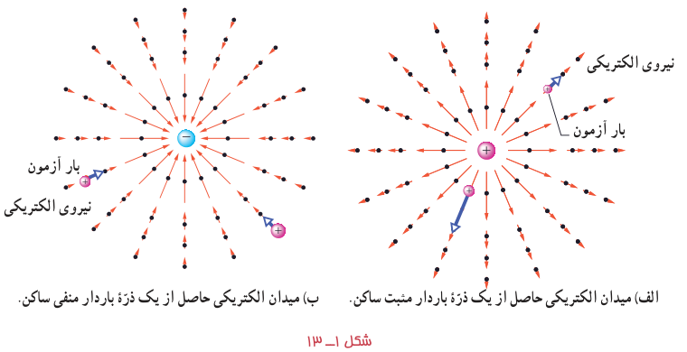
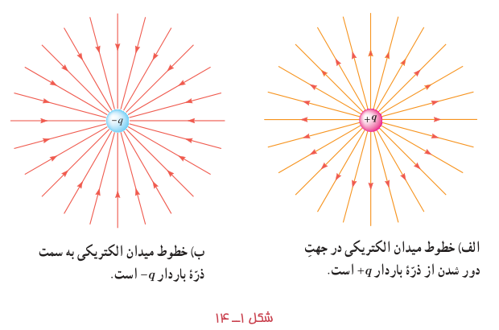
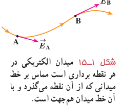
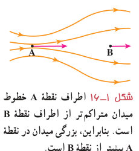

اگر یک بار آزمون را در نزدیکی یک ذرۀ باردار مثبت یا منفی قرار دهیم، بسته به نوع بار، نیروی الکتریکی وارد به بار آزمون در جهت دور شدن از ذره (شکل ۱ـ۱۳ الف) و یا در جهت نزدیک شدن به آن (شکل ۱ـ۱۳ ب) خواهد بود.

خط‌های میدان در هر نقطه، هم‌جهت با بردار میدان الکتریکی در آن نقطه است (شکل ۱ـ۱۴).

بنابراین، طرحی که از سمت‌گیری دانه‌ها در فعالیت ۱ـ۲ دیدید، در واقع طرحی از خطوط میدان الکتریکی در فضای بین دو الکترود بوده است.

قاعده‌های رسم خطوط میدان الکتریکی عبارت‌اند از:

۱ـ در هر نقطه، بردار میدان الکتریکی باید مماس بر خط میدان الکتریکی عبوری از آن نقطه و در همان جهت باشد (شکل ۱ـ۱۵).

۲ـ میزان تراکم خطوط میدان در هر ناحیه از فضا نشان‌دهندۀ اندازۀ میدان در آن ناحیه است؛ هرجا خطوط میدان متراکم‌تر باشند، اندازۀ میدان بیشتر است (شکل ۱ـ۱۶).

