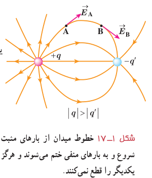
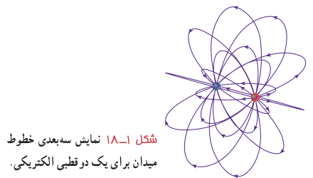
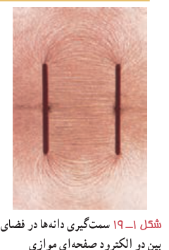
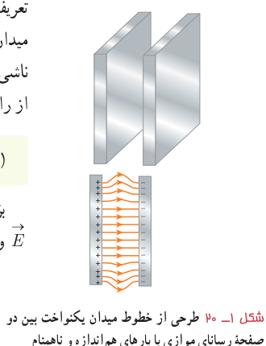

۳ـ در آرایشی از بارها خطوط میدان الکتریکی از بارهای مثبت شروع و به بارهای منفی ختم می‌شوند.

۴ـ خطوط میدان برآیند هرگز یکدیگر را قطع نمی‌کنند (شکل ۱ـ۱۷) یعنی از هر نقطۀ فضا فقط یک خط میدان الکتریکی می‌گذرد.

تجسم واقعی خطوط میدان، در فضاست، و بنابراین طرحی سه‌بعدی دارد (شکل ۱ـ۱۸).

### پرسش ۱ـ۵

به نظر شما چرا خطوط میدان الکتریکی برآیند هرگز یکدیگر را قطع نمی‌کنند؟

**میدان الکتریکی یکنواخت:** اگر دوباره اسباب فعالیت ۱ـ۲ را سوار کنید و این بار الکترودهای نقطه‌ای را با دو صفحۀ فلزی موازی جایگزین کنید و دوباره به سمت‌گیری دانه‌ها در فضای بین دو الکترود توجه کنید، طرحی از خطوط میدان الکتریکی را مشاهده می‌کنید که در شکل ۱ـ۱۹ نشان داده شده است. خطوط این میدان، در فضای بین دو صفحه و دور از لبه‌های صفحات، مستقیم، موازی و هم‌فاصله‌اند؛ یعنی بردار میدان در این نقاط هم‌اندازه و هم‌جهت است. به چنین میدانی، میدان الکتریکی یکنواخت گفته می‌شود (شکل ۱ـ۲۰).

**نیروی الکتریکی وارد بر بار الکتریکی در یک میدان الکتریکی:** گرچه برای تعریف میدان الکتریکی یک جسم باردار از بار آزمون مثبت استفاده کردیم، ولی وجود این میدان مستقل از بار آزمون است. بنابراین، اگر بار الکتریکی ذره‌ای $q$ در میدان الکتریکی $\vec E$ ناشی از اجسام باردار دیگری قرار گیرد، این میدان بر آن نیروی $\vec F$ را وارد می‌کند. نیروی $\vec F$ از رابطۀ زیر به‌دست می‌آید:

$$\vec F=q\vec E\qquad (۱-۶)$$

بزرگی این نیرو از رابطۀ $F=|q|E$ به‌دست می‌آید، و جهت آن اگر $q$ مثبت باشد، در همان جهت $\vec E$ و اگر $q$ منفی باشد، در خلاف جهت $\vec E$ خواهد بود.
