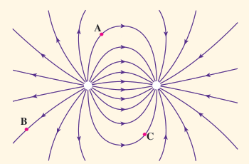
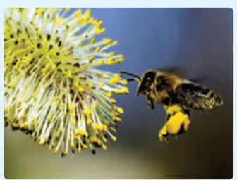
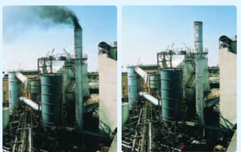

### پرسش ۱ـ۶

بار $-q$ را در نقطه‌های A، B و C از میدان الکتریکی غیریکنواخت شکل روبه‌رو قرار دهید و جهت نیروی الکتریکی وارد بر این بار منفی را تعیین کنید.

### فعالیت ۱ـ۳

تولیدمثل برخی از گل‌ها به زنبورهای عسل وابسته است. گرده‌ها به واسطۀ میدان الکتریکی، از یک گل به زنبور و از زنبور به گل دیگر منتقل می‌شوند. در این باره تحقیق کنید.

### تمرین ۱ـ۷

روی سطح بادکنکی به جرم $10.0\ \mathrm g$ بار الکتریکی $-200\ \mathrm{nC}$ ایجاد می‌کنیم و آن را در یک میدان الکتریکی قرار می‌دهیم. بزرگی و جهت این میدان الکتریکی را در صورتی که بادکنک معلق بماند، تعیین کنید. اندازۀ نیروی شناوری روبه‌بالای وارد بر بادکنک را $0.050\ \mathrm N$ فرض کنید.

### فعالیت ۱ـ۴

رسوب‌دهندۀ الکتروستاتیکی (ESP)¹ دود و غبار را از گازهای زائدی که از دودکش کارخانه‌ها و نیروگاه‌ها بالا می‌آید جدا می‌سازد. رسوب‌دهنده‌ها انواع مختلفی دارند. در مورد اساس کار این رسوب‌دهنده‌ها تحقیق کنید. شکل‌های روبه‌رو تأثیر رسوب‌دهنده را در کاهش آلودگی هوای ناشی از یک دودکش نشان می‌دهد.

۱ـ Electrostatic Precipitator
