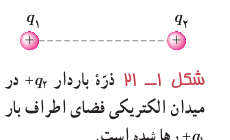
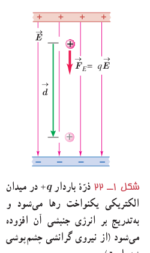
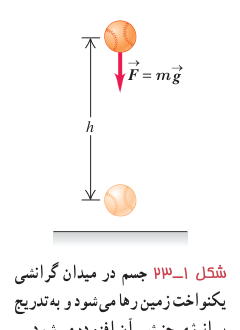

## ۱ـ۷ انرژی پتانسیل الکتریکی

دو ذرۀ باردار الکتریکی شکل ۱ـ۲۱ را درنظر بگیرید که در آن، بار $+q_1$ در جای خود ثابت و بار $+q_2$ در فضای اطراف آن رها شده است. می‌دانیم بار $+q_2$ بر اثر میدان الکتریکی حاصل از بار $+q_1$ از آن رانده و دارای انرژی جنبشی می‌شود. طبق قانون پایستگی انرژی، انرژی جنبشی نمی‌تواند خود به خود به‌وجود آمده باشد. به نظر شما این انرژی جنبشی از کجا آمده است؟ این انرژی، ناشی از تغییر (در اینجا کاهش) انرژی پتانسیلی است که به نیروی الکتریکی بین دو ذرۀ شکل ۱ـ۲۱ وابسته است و همان‌طور که در کتاب فیزیک سال دهم دیدید به آن **انرژی پتانسیل الکتریکی** می‌گوییم. برای آنکه به توصیفی کمی از این انرژی دست یابیم، میدان الکتریکی یکنواختی را مطابق شکل ۱ـ۲۲ درنظر می‌گیریم که در فضای میان دو صفحۀ باردار برقرار شده است.

اگر بار الکتریکی $+q$ را از مجاورت صفحۀ مثبت رها کنیم، تحت تأثیر میدان الکتریکی (با چشم‌پوشی از گرانش)، به طرف صفحۀ منفی شروع به حرکت می‌کند و به‌تدریج تندی و انرژی جنبشی آن افزایش می‌یابد. این وضعیت، شبیه چیزی است که در کتاب فیزیک سال دهم دیدیم. در آنجا نیز مشاهده کردیم که وقتی جسمی به جرم $m$ از ارتفاع $h$ رها می‌شود، جسم رو به پایین حرکت کرده و انرژی جنبشی آن بر اثر کاهش انرژی پتانسیل گرانشی به‌تدریج افزایش می‌یابد (شکل ۱ـ۲۳). همچنین دیدیم که کار نیروی گرانشی برابر با منفی تغییر انرژی پتانسیل گرانشی است ($W_g=-\Delta U_g$).

در اینجا نیز می‌توان گفت: کار نیروی الکتریکی وارد بر یک ذرۀ باردار در میدان الکتریکی یکنواخت $\vec E$ در یک جابه‌جایی مشخص برابر با منفی تغییر انرژی پتانسیل الکتریکی در همان جابه‌جایی است؛ یعنی:

$$W_E=-\Delta U_E\qquad (۱-۷)$$

گرچه این رابطه برای یک میدان الکتریکی یکنواخت بیان شد، ولی می‌توان نشان داد که در حالت کلی نیز برای هر میدان الکتریکی برقرار است.

بار ذره‌ای $q$ را در میدان الکتریکی یکنواخت $\vec E$ درنظر بگیرید که جابه‌جایی $\vec d$ را موازی میدان الکتریکی، انجام می‌دهد (شکل ۱ـ۲۲). طبق تعریف کار که در سال قبل دیدید، کار انجام‌شده توسط نیروی الکتریکی ثابت $\vec F_E$ در طی جابه‌جایی $\vec d$ از رابطۀ زیر به‌دست می‌آید:

$$W_E=(F_E\cos\theta)d=F_Ed\cos\theta$$

با توجه به اینکه $F_E=|q|E$ است، این رابطه به‌صورت زیر می‌شود:

$$W_E=|q|Ed\cos\theta$$

اکنون با استفاده از رابطۀ ۱ـ۷ تغییر انرژی پتانسیل الکتریکی بار ذره‌ای $q$ چنین محاسبه می‌شود:

$$\Delta U_E=-W_E=-|q|Ed\cos\theta\qquad (۱-۸)$$

که در آن، $\theta$ زاویۀ بین نیروی $\vec F_E$ و جابه‌جایی $\vec d$ است. (در این کتاب، در استفاده از رابطۀ ۱ـ۸، صرفاً با جابه‌جایی‌های هم‌راستا با میدان الکتریکی و یا عمود بر میدان الکتریکی سروکار خواهیم
