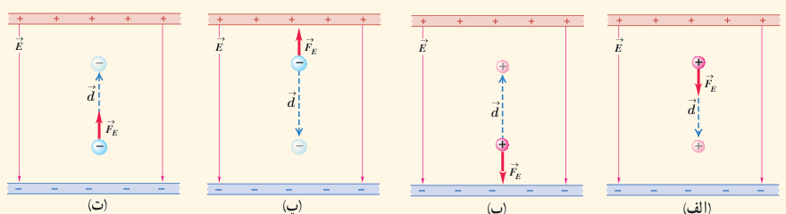
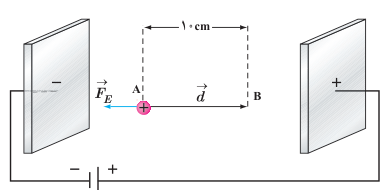

داشت.) در این رابطه، بار الکتریکی ($q$) برحسب کولن (C)، بزرگی میدان الکتریکی ($E$) برحسب نیوتون بر کولن (N/C)، اندازۀ جابه‌جایی ($d$) برحسب متر (m) و تغییر انرژی پتانسیل الکتریکی ($\Delta U_E$) برحسب ژول (J) است. توجه کنید که این رابطه چه برای بار ذره‌ای مثبت و چه برای بار ذره‌ای منفی برقرار است.

### پرسش ۱ـ۷

در هریک از شکل‌های زیر، با توجه به علامت بار ذرۀ جابه‌جا شده، و جهت میدان الکتریکی ($\vec E$)، جهت نیروی الکتریکی ($\vec F_E$) و جهت جابه‌جایی ذره ($\vec d$)، تعیین کنید که:

الف) کار نیروی الکتریکی ($W_E$) مثبت است یا منفی. ب) انرژی پتانسیل الکتریکی ($U_E$) کاهش یافته است یا افزایش.

### مثال ۱ـ۹

در یک میدان الکتریکی یکنواخت $E=2.0\times10^3\ \mathrm{N/C}$، پروتونی از نقطۀ A با سرعت $\vec v_0$ در خلاف جهت میدان الکتریکی پرتاب شده است. پروتون سرانجام در نقطۀ B متوقف می‌شود. بار پروتون $1.6\times10^{-19}\ \mathrm C$ و جرم آن $1.67\times10^{-27}\ \mathrm{kg}$ است.

الف) تغییر انرژی پتانسیل الکتریکی پروتون در این جابه‌جایی چقدر است؟

ب) تندی پرتاب پروتون را پیدا کنید (از وزن پروتون و مقاومت هوا چشم‌پوشی شود).

**پاسخ:** الف) با توجه به رابطۀ ۱ـ۸ داریم:

$$\Delta U_E=-W_E=-|q|Ed\cos\theta=-(1.6\times10^{-19}\ \mathrm C)(2.0\times10^3\ \mathrm{N/C})(10\times10^{-2}\ \mathrm m)(\cos180^\circ)=3.2\times10^{-17}\ \mathrm J$$

ب) طبق قضیۀ کار ـ انرژی جنبشی می‌توان نوشت:

$$W_E=\Delta K\Rightarrow-\Delta U_E=\frac12m(0-v_0^2)$$

$$-3.2\times10^{-17}\ \mathrm J=\frac12(1.67\times10^{-27}\ \mathrm{kg})(-v_0^2)\Rightarrow v_0=1.96\times10^5\ \mathrm{m/s}\approx2.0\times10^5\ \mathrm{m/s}$$

### تمرین ۱ـ۸

در مثال ۱ـ۹ اگر جای قطب‌های باتری عوض شود و پروتون را در نقطۀ A از حالت سکون رها کنیم، پروتون با چه تندی‌ای به نقطۀ B می‌رسد؟
