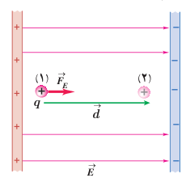
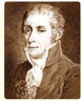

## ۱ـ۸ پتانسیل الکتریکی

در بخش قبل دیدیم تغییر انرژی پتانسیل الکتریکی یک ذرۀ باردار به بار الکتریکی آن بستگی دارد؛ مثلاً با دو برابر شدن بار ذره، تغییر انرژی پتانسیل الکتریکی آن نیز دو برابر می‌شود. بنابراین، نسبت تغییر انرژی پتانسیل به بار ذره، مستقل از نوع و اندازۀ بار الکتریکی است. به این نسبت، **اختلاف پتانسیل الکتریکی** دو نقطه‌ای می‌گوییم که ذره میان آنها جابه‌جا شده است (شکل ۱ـ۲۴) و آن را با $\Delta V$ نمایش می‌دهیم:

$$\Delta V=V_2-V_1=\frac{\Delta U_E}{q}\qquad (۱-۹)$$

که در آن $V$ کمیتی نرده‌ای موسوم به پتانسیل الکتریکی است که مقدار آن در نقطه‌های ۱ و ۲ به ترتیب $V_1$ و $V_2$ است. در این رابطه، اختلاف پتانسیل الکتریکی ($\Delta V$) برحسب ژول بر کولن (J/C) است که آن را به افتخار الساندرو ولتا، ولت می‌نامند و با نماد V نمایش می‌دهند.

گرچه این رابطه را برای میدان الکتریکی یکنواخت بیان کردیم، اما برای میدان‌های الکتریکی غیریکنواخت نیز برقرار است. توجه کنید که در این رابطه علامت $q$ باید در نظر گرفته شود. جدول ۱ـ۲ برخی از اختلاف پتانسیل‌ها (ولتاژهای) متداول را نشان می‌دهد.

در تشابه با انرژی پتانسیل گرانشی، در اینجا نیز می‌توانیم برای انرژی پتانسیل الکتریکی، مرجعی اختیار کنیم که در آن انرژی پتانسیل الکتریکی ذره و پتانسیل الکتریکی صفر باشد. بنابراین، پتانسیل الکتریکی در هر نقطه از میدان با رابطۀ زیر بیان می‌شود:

$$V=\frac{U_E}{q}\qquad (۱-۱۰)$$

**جدول ۱ـ۲ برخی از ولتاژهای متداول**

| مورد | ولتاژ |
|---|---|
| پتانسیل استراحت نورون | ۶۰–۹۰ mV |
| باتری قلمی | ۱/۵ V |
| باتری اتومبیل | ۱۲ V |
| برق خانگی در برخی از کشورها | ۱۱۰–۱۲۰ V |
| برق خانگی در ایران و اغلب کشورها | ۲۲۰–۲۴۰ V |
| مولد نیروگاه برق | ۲۴۰۰۰ V |
| خطوط انتقال برق ولتاژ بالا | $10^4$–$10^6$ V |
| آذرخش | $10^8$–$10^9$ V |

**الساندرو ولتا (۱۸۲۷–۱۷۴۵ م)**

الساندرو ولتا در ایتالیا به دنیا آمد. نخست به شغل معلمی روی آورد و تا سن سی‌سالگی به این کار ادامه داد. سپس در دانشگاه پاویا به استادی فیزیک برگزیده شد. در آنجا وظیفه داشت علاوه بر تدریس، آزمایشگاهی نیز دایر کند. وقتی در دانشگاه تدریس می‌کرد دستگاهی به نام الکتروفور را اختراع کرد و شرح جزئیات دستگاه را برای جوزف پریستلی فرستاد. ولتا با استفاده از این دستگاه، قوانین فیزیکی زیادی را کشف کرد. در سال ۱۷۹۱ لوئیجی گالوانی استاد زیست‌شناسی و فیزیولوژی دانشگاه بولونیا موقعی که سرگرم تشریح قورباغه‌ای در آزمایشگاهش بود، یک گرۀ برنجی را در نخاع جانور قرار داد و متوجه شد که پس از برخورد ماهیچۀ پای قورباغه با چاقوی جراحی، خصوصاً وقتی قسمت بالای چاقو با گره تماس پیدا کند، ماهیچه به‌شدت منقبض می‌شود و علت انقباض ماهیچۀ پای قورباغه را الکتریسیته‌ای پنداشت که در بدن جانور به‌وجود می‌آید. اما ولتا برخلاف گالوانی عقیده داشت منشأ پیدایش این الکتریسیته از بدن جانور نیست و در نامه‌ای به تاریخ ۱۸۰۰ میلادی دربارۀ پیلی توضیح داد که امروزه پیل ولتا خوانده می‌شود. پیل ولتا از تعدادی صفحات نقره، مقوای آغشته به یک محلول الکترولیت و روی درست شده است که به ترتیب روی هم چیده شده‌اند. این پیل یک منبع الکتریسیته بود که امروزه به نام باتری خشک مورد استفاده قرار می‌گیرد. اختراع ولتا راه تازه‌ای را در پیشرفت علم گشود و با استفاده از پیل ولتا، دانشمندان توانستند در مدت زمان کوتاهی آب را به دو عنصر اکسیژن و هیدروژن تجزیه کنند.

