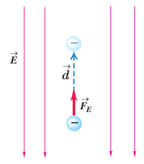

### مثال ۱ـ۱۰

در نتیجۀ برخورد پرتوهای کیهانی با مولکول‌های هوا، الکترون‌هایی از این مولکول‌ها کنده می‌شوند. در نزدیکی سطح زمین، میدان الکتریکی با بزرگی $150\ \mathrm{N/C}$ و جهت رو به پایین وجود دارد. الف) اگر یکی از این الکترون‌ها، تحت تأثیر این میدان $500\ \mathrm m$ رو به بالا جابه‌جا شود، انرژی پتانسیل الکتریکی آن چقدر تغییر می‌کند؟ ب) اختلاف پتانسیل الکتریکی دو نقطه‌ای که الکترون بین آنها جابه‌جا شده چقدر است؟

**پاسخ:** الف) با استفاده از رابطۀ ۱ـ۸ برای تغییر انرژی پتانسیل الکتریکی الکترون داریم:

$$\Delta U_E=-W_E=-|q|Ed\cos\theta=-(1.60\times10^{-19}\ \mathrm C)(150\ \mathrm{N/C})(500\ \mathrm m)\cos0^\circ=-1.20\times10^{-14}\ \mathrm J$$

ب) با استفاده از رابطۀ ۱ـ۹ برای اختلاف پتانسیل داریم:

$$\Delta V=\frac{\Delta U_E}{q}=\frac{-1.20\times10^{-14}\ \mathrm J}{-1.60\times10^{-19}\ \mathrm C}=7.50\times10^4\ \mathrm V=75.0\ \mathrm{kV}$$

### تمرین ۱ـ۹

الف) نشان دهید در یک میدان الکتریکی یکنواخت، با حرکت در سوی خطوط میدان، بدون توجه به نوع بار، پتانسیل الکتریکی کاهش می‌یابد و بالعکس با حرکت در خلاف جهت خطوط میدان، بدون توجه به نوع بار، پتانسیل الکتریکی افزایش می‌یابد.

ب) نشان دهید در میدان الکتریکی یکنواخت، با حرکت در جهت عمود بر خطوط میدان، پتانسیل الکتریکی تغییر نمی‌کند.

شما با انواع باتری‌ها که در وسیله‌های الکتریکی نظیر چراغ قوه یا گوشی تلفن همراه از آنها استفاده می‌شود (شکل ۱ـ۲۵) و نیز با باتری خودرو آشنایی دارید. باتری‌ها ولتاژهای متفاوتی دارند؛ مثلاً باتری خودروهای سواری معمولاً ۱۲ ولتی و باتری کامیون‌ها ۲۴ ولتی یا بیشترند. هر باتری دو پایانه دارد که یکی با مثبت و دیگری با منفی نشان داده می‌شود. بنا به قرارداد، اختلاف پتانسیل الکتریکی دو سر باتری برابر با پتانسیل پایانۀ مثبت منهای پتانسیل پایانۀ منفی است. اگر پتانسیل پایانۀ منفی را با $V_-$ و پتانسیل پایانۀ مثبت را با $V_+$ نشان دهیم، داریم:

$$\Delta V=V_+-V_-$$

بنابراین، وقتی می‌گوییم باتری خودرو ۱۲ ولت است، یعنی پتانسیل پایانۀ مثبت به اندازۀ ۱۲ ولت از پتانسیل پایانۀ منفی آن بیشتر است؛ مثلاً اگر پتانسیل پایانۀ منفی را برابر با $-4\ \mathrm V$ فرض کنیم، پتانسیل پایانۀ مثبت برابر $+8\ \mathrm V$ خواهد شد. می‌توان پایانۀ منفی را مرجع پتانسیل درنظر گرفت؛ در این صورت، پتانسیل پایانۀ مثبت برابر $+12\ \mathrm V$ می‌شود. معمولاً (به‌خصوص در مهندسی برق) پتانسیل زمین یا نقطه‌ای از مدار را برابر صفر می‌گیرند و به آن نقطه، اصطلاحاً نقطۀ زمین می‌گویند و پتانسیل نقطه‌های دیگر را نسبت به آن می‌سنجند. نقطۀ زمین را در مدارهای الکتریکی با نماد زمین نشان می‌دهند.

