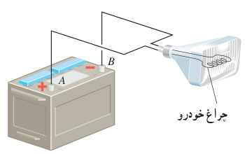
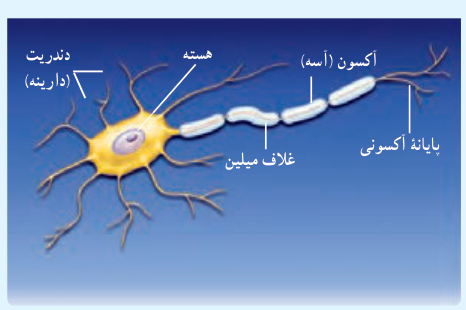

### تمرین ۱ـ۱۰

اگر پایانۀ مثبت یک باتری ۱۲ ولتی را مرجع پتانسیل درنظر بگیریم، پتانسیل پایانۀ منفی آن چند ولت خواهد شد؟

### مثال ۱ـ۱۱

اختلاف پتانسیل الکتریکی پایانه‌های باتری خودروی نشان داده شده در شکل برابر $12.0\ \mathrm V$ است. اگر بار الکتریکی $-50.0$ کولن از پایانۀ منفی به پایانۀ مثبت باتری جابه‌جا شود، انرژی پتانسیل الکتریکی آن چقدر تغییر می‌کند؟

**پاسخ:** با استفاده از رابطۀ ۱ـ۹ داریم:

$$\Delta V=\frac{\Delta U_E}{q}$$

$$\Delta U=q\Delta V=q(V_+-V_-)=(-50.0\ \mathrm C)(+12.0\ \mathrm V)=-600\ \mathrm J$$

بنابراین، انرژی پتانسیل الکتریکی این بار به اندازۀ $600\ \mathrm J$ کاهش یافته است.

### فعالیت ۱ـ۵

عمل مغز اساساً برمبنای کنش‌ها و فعالیت‌های الکتریکی است. سیگنال‌های عصبی چیزی جز عبور جریان‌های الکتریکی نیست. مغز این سیگنال‌ها را دریافت می‌کند و اطلاعات به‌صورت سیگنال‌های الکتریکی در امتداد اعصاب گوناگون منتقل می‌شوند. هنگام انجام هر عمل خاصی، سیگنال‌های الکتریکی زیادی تولید می‌شوند. این سیگنال‌ها حاصل کنش الکتروشیمیایی در یاخته‌های عصبی موسوم به نورون هستند. دربارۀ چگونگی کار نورون‌ها تحقیق و به کلاس گزارش کنید.

**رابطۀ اختلاف پتانسیل دو نقطه و اندازۀ میدان الکتریکی یکنواخت:** همان‌طور که پیش‌تر گفتیم اختلاف پتانسیل الکتریکی دو نقطه از میدان الکتریکی، مستقل از نوع و اندازۀ بار جابه‌جا شده بین دو نقطه است. برای اختلاف پتانسیل $\Delta V$ی دو نقطه به فاصلۀ $d$ از یکدیگر، که خط واصل آنها هم‌راستا با میدان الکتریکی $\vec E$ است، رابطۀ زیر برقرار است:

$$|\Delta V|=Ed\qquad (۱-۱۱)$$

در این رابطه $\Delta V$ برحسب ولت، $E$ برحسب نیوتون بر کولن، و $d$ برحسب متر است. بنابراین می‌توان نوشت: $1\ \mathrm{N/C}=1\ \mathrm{V/m}$.
