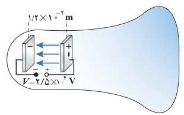
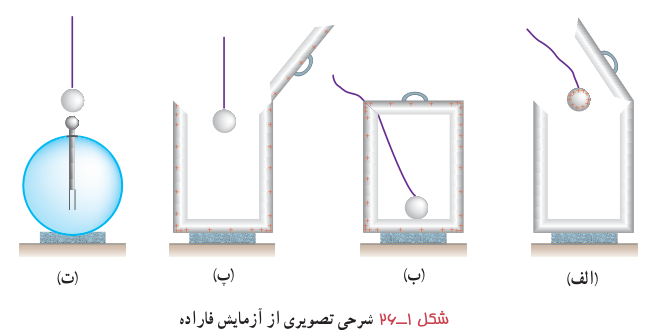

### مثال ۱ـ۱۲

لامپ‌های تصویر تلویزیون‌ها و نمایشگرهای قدیمی، لامپ پرتو ـ کاتدی (CRT)¹ بودند. در این لامپ، الکترون‌ها در میدان الکتریکی یکنواخت بین دو صفحۀ باردار، مطابق شکل، شتاب می‌گیرند و با صفحۀ نمایشگر برخورد می‌کنند. اگر صفحه‌ها در فاصلۀ $1.2\times10^{-2}\ \mathrm m$ از یکدیگر باشند و اختلاف پتانسیل بین آنها $2.5\times10^4\ \mathrm V$ باشد، بزرگی میدان الکتریکی بین صفحه‌ها را تعیین کنید.

**پاسخ:** با استفاده از رابطۀ ۱ـ۱۱ داریم:

$$E=\frac{|\Delta V|}{d}=\frac{2.5\times10^4\ \mathrm V}{1.2\times10^{-2}\ \mathrm m}=2.08\times10^6\ \mathrm{V/m}\approx2.1\ \mathrm{MV/m}$$

## ۱ـ۹ توزیع بار الکتریکی در اجسام رسانا

جسم رسانایی را درنظر بگیرید. به نظر شما اگر باری اضافی به این جسم داده شود، چگونه در آن توزیع می‌شود؟ مایکل فاراده در سال ۱۸۳۶ میلادی با انجام آزمایشی به این سؤال پاسخ داد.

**آزمایش فاراده:** ظرف رسانایی با درپوش فلزی را درنظر بگیرید که روی پایۀ نارسانایی قرار دارد و روی درپوش آن دسته‌ای عایق نصب شده است. ابتدا ظرف بدون بار است. یک گوی فلزی را که از نخ عایقی آویزان است باردار و سپس وارد ظرف می‌کنیم (شکل ۱ـ۲۶ الف). اکنون گوی را با کف ظرف تماس می‌دهیم و سپس درپوش فلزی را می‌بندیم (شکل ۱ـ۲۶ ب). آن‌گاه درپوش فلزی را با دستۀ عایقش برمی‌داریم (شکل ۱ـ۲۶ پ). پس از خارج کردن گوی فلزی از ظرف، آن را به کلاهک الکتروسکوپ نزدیک می‌کنیم. مشاهده می‌شود عقربۀ الکتروسکوپ تکان نمی‌خورد (شکل ۱ـ۲۶ ت). همچنین اگر ظرف را به الکتروسکوپ نزدیک کنیم، مشاهده می‌شود که عقربه‌های الکتروسکوپ از هم فاصله می‌گیرند. از این آزمایش نتیجه می‌گیریم که بار اضافی داده‌شده به یک رسانا روی سطح خارجی آن توزیع می‌شود.

۱ـ Cathode – Ray Tube
