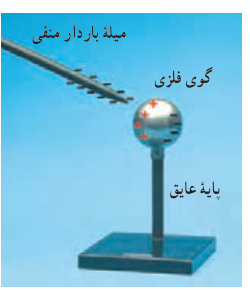
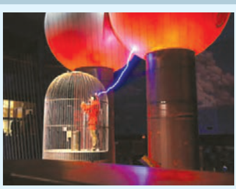
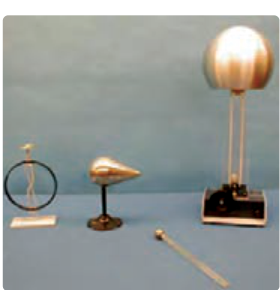

خوب است بدانید بار در سطح خارجی رسانا به‌گونه‌ای توزیع می‌شود که میدان الکتریکی در داخل رسانا صفر شود. پدیدۀ القا که در علوم هشتم با آن آشنا شدید ناشی از همین واقعیت است. مثلاً در شکل ۱ـ۲۷ جسم رسانای خنثایی در میدان الکتریکی خارجی میلۀ بارداری قرار گرفته است. وقتی یک رسانای خنثی را در یک میدان الکتریکی خارجی قرار می‌دهیم، بار طوری روی سطح خارجی توزیع می‌شود (القا می‌شود) که میدان الکتریکی ناشی از آن اثر میدان خارجی را درون رسانا خنثی کند و بدین ترتیب میدان الکتریکی خالص درون رسانا صفر شود.

### فعالیت ۱ـ۶

الف) در شکل شخصی را داخل یک قفس توری فلزی می‌بینید که نوعی از قفس فاراده است. در مورد قفس فاراده و کاربردهایش تحقیق و به کلاس گزارش کنید.

ب) چرا معمولاً شخصی که در داخل اتومبیل یا هواپیماست از خطر آذرخش در امان می‌ماند.

پ) با اعضای گروه خود آزمایش‌های دیگری را طراحی و اجرا کنید که نشان دهد بار اضافی داده شده به رسانا، روی سطح داخلی رسانا توزیع نمی‌شود.

دیدیم که بار الکتریکی روی سطح خارجی رسانا توزیع می‌شود. برای اینکه دریابید بار الکتریکی داده‌شده به یک رسانا چگونه روی سطح خارجی آن توزیع می‌شود آزمایش زیر را درنظر بگیرید که اسباب آن در شکل ۱ـ۲۸ نشان داده شده است. یک جسم رسانای دوکی‌شکل را روی پایۀ عایق قرار دهید و آن را با تماس با کلاهک مولد وان‌دوگراف باردار کنید. گلوله‌ای فلزی را که به دسته‌ای عایق متصل است با بخش پهن دوک تماس داده و سپس گلوله را به سر الکتروسکوپ تماس دهید. همین آزمایش را پس از خنثی کردن الکتروسکوپ و گوی فلزی با تماس با دستان، با نوک تیز دوک انجام دهید. خواهید دید، انحراف صفحه‌های الکتروسکوپ با نوک تیز دوک بیشتر از انحراف صفحه‌ها با بخش پهن

