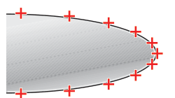
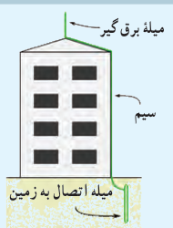
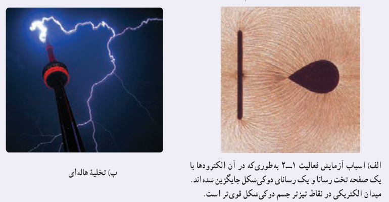

آن است. آزمایش‌هایی از این دست نشان می‌دهد تراکم بار در نقاط تیز سطح جسم رسانای باردار از نقاط دیگر آن بیشتر است (شکل ۱ـ۲۹).

### فعالیت ۱ـ۷

در مورد برق‌گیرهای ساختمان تحقیق کنید و بررسی کنید آنها چگونه ساختمان‌ها را از گزند آذرخش در امان نگه می‌دارند.

### خوب است بدانید: تخلیۀ هاله‌ای¹

همان‌طور که دیدیم در قسمت‌های نوک‌تیز اجسام رسانای باردار، تراکم بار الکتریکی بیشتر است. با اسباب آزمایش فعالیت ۱ـ۲ می‌توان نشان داد که خطوط میدان الکتریکی در نقاط نوک‌تیز متراکم‌تر و در نتیجه میدان الکتریکی قوی‌تر است (شکل الف). اگر بزرگی این میدان از یک مقدار حدی فراتر برود، این میدان شدید می‌تواند الکترون‌ها را از مولکول‌های هوا بکَند و به آنها شتاب دهد. برخورد این الکترون‌ها با مولکول‌های دیگر موجب برانگیختگی این مولکول‌ها می‌شود و در نتیجه نوری تولید می‌شود که قابل مشاهده است (شکل ب). هنگام وقوع این پدیده، جنبش مولکولی، دما، و فشار هوا در محل وقوع این پدیده زیاد می‌شود که این معمولاً همراه با صدای جِز و وِز و هیس مانندی است که در حین تخلیه‌های جرقه‌ای شنیده می‌شود. به این جرقه‌های الکتریکی که در نوک تیز اجسام رسانای بلند و نازک ایجاد می‌شود، تخلیۀ هاله‌ای یا آتش سنت اِلمو² گفته می‌شود.

۱ـ Corona discharge

۲ـ St. Elmo fire
