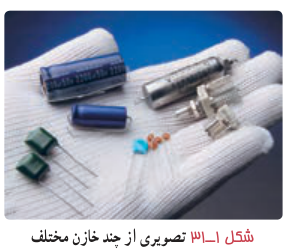
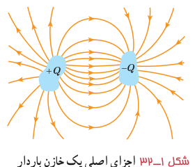
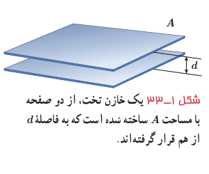
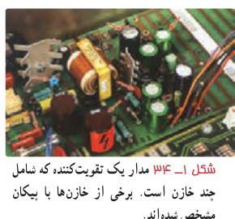

## ۱ـ۱۰ خازن

خازن وسیله‌ای الکتریکی است که می‌تواند بار و انرژی الکتریکی را در خود ذخیره کند؛ مثلاً باتری‌های یک دوربین با باردار کردن یک خازن، انرژی را در خازن فلاش دوربین ذخیره می‌کنند (شکل ۱ـ۳۰). باتری‌ها معمولاً می‌توانند انرژی را فقط با آهنگ نسبتاً کمی به مدار بدهند که این آهنگ برای گسیل نور از فلاش دوربین بسیار کم است، اما وقتی خازن باردار می‌شود، می‌تواند انرژی را با آهنگ بسیار زیادی برای فلاش زدن آماده کند.

شکل ۱ـ۳۱ چند خازن را در اندازه‌ها و شکل‌های مختلف نشان می‌دهد. شکل ۱ـ۳۲ اجزای اصلی یک خازن معمولی را نشان می‌دهد که شامل دو رسانا با هر شکلی است. این رساناها را صفحه‌های خازن می‌نامیم.

شکل ۱ـ۳۳ آرایش خازنی موسوم به خازن تخت¹ را نشان می‌دهد که شامل دو صفحۀ رسانای موازی با مساحت $A$ است که به فاصلۀ $d$ (که در برابر ابعاد صفحه‌ها ناچیز است) از هم قرار گرفته‌اند. گرچه نمادی که برای نشان دادن یک خازن به‌کار می‌بریم مبتنی بر شکل یک خازن تخت است، ولی از آن برای نشان دادن خازن‌ها با هر شکلی استفاده می‌شود. خازن‌ها به‌طور گسترده‌ای در مدارهای الکترونیکی وسایلی مانند رادیو، تلویزیون، رایانه، گوشی همراه و ... به‌کار می‌روند؛ مثلاً شکل ۱ـ۳۴ مدار یک تقویت‌کننده (آمپلی‌فایر) را نشان می‌دهد که در آن چندین خازن به کار رفته است. برخی از این خازن‌ها با پیکان‌هایی مشخص شده‌اند.

**باردار (شارژ) کردن خازن:** روش ساده و مرسوم برای باردار کردن خازن قرار دادن آن در مدار الکتریکی ساده‌ای است که یک باتری دارد (شکل ۱ـ۳۵ الف). وقتی کلید K بسته (وصل) شود بار از طریق سیم‌های رسانا جریان می‌یابد. این شارش بار تا هنگامی ادامه پیدا می‌کند که اختلاف پتانسیل میان دو صفحۀ خازن با اختلاف پتانسیل میان دو پایانۀ باتری یکسان شود. وقتی یک خازن باردار می‌شود، صفحه‌های آن دارای بارهایی با بزرگی یکسان، ولی با علامت مخالف می‌شود: $+Q$ و $-Q$. با این حال، بار یک خازن را به‌صورت $Q$ نشان می‌دهند که همان بار صفحۀ مثبت است. بین دو صفحۀ خازن باردار یک میدان الکتریکی ایجاد می‌شود که خطوط این میدان از صفحۀ مثبت به منفی است (شکل ۱ـ۳۵ ب).

۱ـ parallel – plate capacitor
