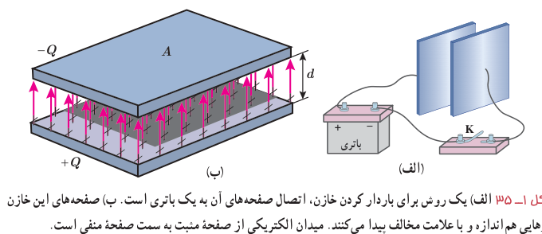
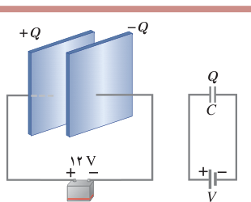

**ظرفیت خازن:** اگر اختلاف پتانسیل بین صفحه‌های خازن ($\Delta V$) را زیاد کنیم، بار خازن ($Q$) نیز به همان نسبت زیاد می‌شود. به‌عبارتی نسبت $Q/\Delta V$ همواره مقداری ثابت است که به این نسبت ثابت، ظرفیت خازن می‌گویند و آن را با $C$ نشان می‌دهند. عبارت ظرفیت الکتریکی را نخستین بار ولتا در تشابه با ظرفیت گرمایی به‌کار برد. بنا به دلایل تاریخی، قدرمطلق اختلاف پتانسیل $\Delta V$ بین دو صفحۀ خازن را با $V$ نمایش می‌دهند. بنابراین:

$$C=\frac QV\qquad (۱-۱۲)$$

در رابطۀ ۱ـ۱۲ یکای بار الکتریکی، کولن (C)، یکای اختلاف پتانسیل، ولت (V) و بنابراین یکای ظرفیت، کولن بر ولت (C/V) می‌شود که به پاس خدمات مایکل فاراده، فاراد (F) نامیده شده است. فاراد یکای بسیار بزرگی است و عملاً ظرفیت اکثر خازن‌های متداول در محدودۀ پیکوفاراد ($10^{-12}\ \mathrm F$) تا میلی‌فاراد ($10^{-3}\ \mathrm F$) است. گرچه امروزه فناوری ساخت خازن‌ها، دستیابی به ظرفیت‌هایی بسیار بیشتر را نیز ممکن ساخته است.

ظرفیت خازن به ویژگی‌های هندسی و جنس عایق بین صفحه‌های خازن بستگی دارد و با تغییر بار یا اختلاف پتانسیل خازن، تغییر نمی‌کند.

### مثال ۱ـ۱۳

صفحه‌های خازنی را مطابق شکل به پایانه‌های یک باتری با اختلاف پتانسیل $12\ \mathrm V$ وصل می‌کنیم. اگر بار خازن $24\ \mu\mathrm C$ شود،

الف) ظرفیت خازن را محاسبه کنید.

ب) اگر این خازن را به اختلاف پتانسیل $36\ \mathrm V$ وصل کنیم، بار الکتریکی آن چقدر می‌شود؟

**پاسخ:** الف) با استفاده از رابطۀ ۱ـ۱۲ داریم:

$$C=\frac QV=\frac{24\times10^{-6}\ \mathrm C}{12\ \mathrm V}=2.0\times10^{-6}\ \mathrm F=2.0\ \mu\mathrm F$$

ب) با توجه به اینکه ظرفیت خازن همواره مقدار ثابتی است از ظرفیت به‌دست آمده در قسمت الف استفاده می‌کنیم. آنگاه با استفاده از رابطۀ ۱ـ۱۲ می‌توان نوشت:

$$Q=CV=(2.0\times10^{-6}\ \mathrm F)(36\ \mathrm V)=72\times10^{-6}\ \mathrm C=72\ \mu\mathrm C$$
