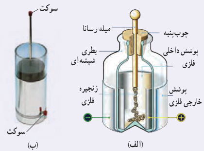
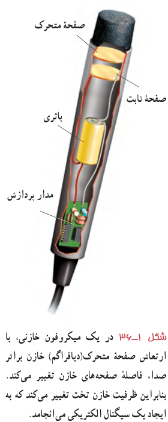
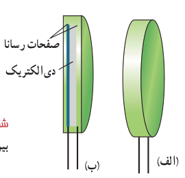

### خوب است بدانید: بطری لیدن¹

بطری لیدن، قدیمی‌ترین نوع خازن است که در میانۀ سدۀ هجدهم در شهر لیدن که امروزه در هلند واقع شده است، ساخته شد. در یک نوع ابتدایی، این خازن از یک بطری شیشه‌ای ساخته شده است که سطح درونی و بیرونی آن با ورقۀ نازک قلع پوشیده شده است. ورقۀ درونی توسط سیم یا زنجیری فلزی به میلۀ فلزی ثابت داخل بطری اتصال دارد (شکل الف). امروزه برای باردار کردن بطری لیدن، روی بدنۀ فلزی و سر میلۀ فلزی سوکت (جای فیش)هایی نصب شده است (شکل ب) که از طریق آنها، خازن توسط قطب‌های یک مولد ولتاژ بالا مانند مولد وان‌دوگراف یا مولد ویم‌هرست² باردار می‌شود. ظرفیت یک بطری لیدن با اندازۀ متوسط از مرتبۀ $1\ \mathrm{nF}$ است. آزمایش با بطری لیدن خطرناک است و باید تحت نظارت مربی یا دبیر محترم انجام شود.

**ظرفیت خازن تخت:** آزمایش و محاسبه نشان می‌دهد که ظرفیت یک خازن تخت با مساحت صفحه‌های $A$ و فاصلۀ جدایی صفحه‌های $d$، از رابطۀ زیر به دست می‌آید:

$$C_0=\varepsilon_0\frac Ad\qquad (۱-۱۳)$$

که در آن $\varepsilon_0$ همان ضریب گذردهی الکتریکی خلأ ($\varepsilon_0=8.85\times10^{-12}\ \mathrm{F/m}$) است. مثالی کاربردی از این رابطه، میکروفون خازنی است که بر اثر تغییر ظرفیت یک خازن تخت سیگنال الکتریکی ایجاد می‌کند (شکل ۱ـ۳۶).

حال اگر فضای میان صفحه‌های یک خازن را با ماده‌ای عایق (مانند کاغذ یا پلاستیک) که به آن دی‌الکتریک گفته می‌شود پُر کنیم (شکل ۱ـ۳۷) برای ظرفیت خازن چه پیش می‌آید؟ مایکل فاراده نخستین بار در سال ۱۸۳۷ میلادی، با استفاده از وسایل ساده‌ای دریافت که ظرفیت خازن با ضریبی موسوم به ثابت دی‌الکتریک مادۀ عایق (که آن را با $\kappa$³ نشان می‌دهند) افزایش می‌یابد؛ یعنی اگر ظرفیت

۱ـ Leyden jar

۲ـ Wimshurst Machine

۳ـ از حروف الفبای یونانی که کاپا خوانده می‌شود.
