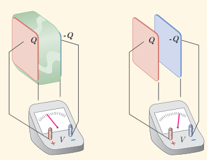
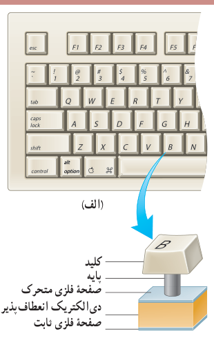

خازن بدون دی‌الکتریک را با $C_0$ نمایش دهیم، آن‌گاه ظرفیت خازن با دی‌الکتریک برابر است با:

$$C=\kappa C_0\qquad (۱-۱۴)$$

جدول ۱ـ۳ ثابت دی‌الکتریک چند مادۀ عایق را نشان می‌دهد.

**جدول ۱ـ۳ ثابت دی‌الکتریک برخی عایق‌ها در دمای ۲۰°C**

| مادۀ دی‌الکتریک | ثابت دی‌الکتریک |
|---|---|
| هوای ۱ atm | ۱/۰۰۰۶ |
| تفلون | ۲/۱ |
| پارافین | ۲/۲ |
| پلی‌استیرن | ۲/۶ |
| میلر | ۳/۱ |
| پی‌وی‌سی | ۳/۴ |
| کاغذ | ۳/۵ |
| کوارتز | ۴/۳ |
| شیشۀ پیرکس | ۵ |
| میکا | ۷ |
| آب خالص | ۸۰ |
| تیتانید استرانسیم | ۳۱۰ |

### پرسش ۱ـ۸

در شکل زیر صفحه‌های باردار یک خازن تخت را که بین آنها هواست، به ولت‌سنج وصل می‌کنیم. با وارد کردن دی‌الکتریک در بین صفحه‌ها، اختلاف پتانسیل دو صفحه کاهش می‌یابد. علت آن را توضیح دهید (توجه کنید که این آزمایش با بیشتر ولت‌سنج‌های معمولی و رایج ممکن نیست).

### مثال ۱ـ۱۴

برخی از صفحه‌کلیدهای رایانه (شکل الف) بر مبنای تغییر ظرفیت خازن عمل می‌کنند. هر کلید این صفحه به یک سر پایه‌ای نصب شده است که سر دیگر آن به یک صفحۀ فلزی متحرک متصل است. این صفحۀ فلزی خود توسط یک دی‌الکتریک انعطاف‌پذیر از صفحۀ فلزی ثابتی جدا شده است و در واقع این دو صفحه یک خازن تخت را تشکیل می‌دهند (شکل ب). با فشار دادن کلید، صفحۀ متحرک به صفحۀ ثابت نزدیک می‌شود و ظرفیت خازن افزایش می‌یابد. این تغییر ظرفیت به‌صورت سیگنالی الکتریکی توسط مدارهای الکترونیکی رایانه آشکار می‌شود و بدین‌ترتیب، مشخص می‌شود که کدام کلید فشار داده شده است. فاصلۀ بین صفحه‌ها عموماً $5.00\times10^{-3}\ \mathrm m$ است که این فاصله با فشار دادن کلید به $0.150\times10^{-3}\ \mathrm m$ می‌رسد. مساحت صفحه‌ها $9.50\times10^{-5}\ \mathrm{m^2}$ است و خازن از ماده‌ای با ثابت دی‌الکتریک $3.50$ پر شده است. تغییر ظرفیتی که با فشار دادن کلید، توسط مدارهای الکترونیکی رایانه آشکار می‌شود چقدر است؟

