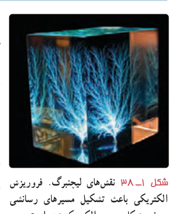
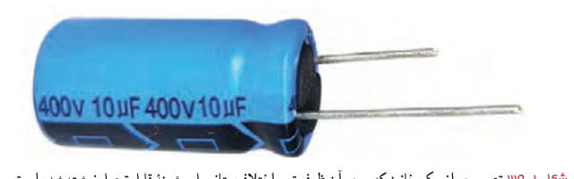

**پاسخ:** با استفاده از رابطه‌های ۱ـ۱۳ و ۱ـ۱۴ ظرفیت خازن پیش از فشار دادن کلید برابر است با:

$$C=\kappa\varepsilon_0\frac Ad=3.50(8.85\times10^{-12}\ \mathrm{F/m})\frac{9.50\times10^{-5}\ \mathrm{m^2}}{5.00\times10^{-3}\ \mathrm m}=0.589\times10^{-12}\ \mathrm F=0.589\ \mathrm{pF}$$

پس از فشرده شدن کلید، فاصلۀ بین صفحه‌ها به $0.150\times10^{-3}\ \mathrm m$ می‌رسد و با محاسبه‌ای مشابه به $C=19.6\times10^{-12}\ \mathrm F=19.6\ \mathrm{pF}$ می‌رسیم. بنابراین، تغییر ظرفیت خازن که به‌صورت سیگنالی آشکار می‌شود از تفاضل دو مقدار بالا به‌دست می‌آید:

$$\Delta C=19.6\ \mathrm{pF}-0.589\ \mathrm{pF}=19.0\ \mathrm{pF}$$

### فعالیت ۱ـ۸

در حسگر کیسۀ هوای برخی از خودروها از یک خازن استفاده می‌شود. دربارۀ چگونگی عملکرد این حسگرها تحقیق کنید و نتیجۀ آن را به کلاس گزارش دهید.

**فروریزش الکتریکی:** دیدیم که با قرار گرفتن مادۀ دی‌الکتریک بین صفحات خازن، ظرفیت خازن تغییر می‌کند. اثر دیگر حضور دی‌الکتریک‌ها در خازن، تغییر حداکثر ولتاژ قابل تحمل خازن است. اگر اختلاف پتانسیل دو صفحۀ یک خازن را به اندازۀ کافی زیاد کنیم، تعدادی از الکترون‌های اتم‌های مادۀ دی‌الکتریک، توسط میدان الکتریکی ایجادشده بین دو صفحه، کنده می‌شوند و مسیرهایی رسانا درون دی‌الکتریک¹ ایجاد می‌شود (شکل ۱ـ۳۸) که سبب تخلیۀ خازن می‌گردد. به این پدیده فروریزش الکتریکی² مادۀ دی‌الکتریک می‌گویند. فروریزش الکتریکی در عایق بین دو صفحۀ خازن‌ها معمولاً، با ایجاد یک جرقه همراه است و در بیشتر مواقع خازن را می‌سوزاند. خازن‌ها معمولاً با مقدار ظرفیت آنها و اختلاف پتانسیل بیشینه‌ای که می‌توانند تحمل کنند مشخص می‌شوند (شکل ۱ـ۳۹).

۱ـ موسوم به نقش‌های لیچتنبرگ (Lichtenberg)

۲ـ Electrical Breakdown
