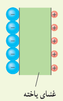
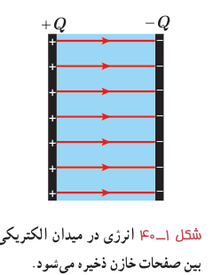
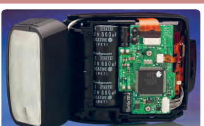

### تمرین ۱ـ۱۱

یک یاختۀ عصبی (نورون) را می‌توان با یک خازن تخت مدل‌سازی کرد، به‌طوری که غشای سلول به عنوان دی‌الکتریک و یون‌های باردار با علامت مخالف که در دو طرف غشا هستند به عنوان بارهای روی صفحه‌های خازن عمل کنند (شکل روبه‌رو). ظرفیت یک سلول عصبی و تعداد یون‌های لازم (با فرض آنکه هر یون یک بار یونیده باشد)، برای آنکه یک اختلاف پتانسیل $85\ \mathrm{mV}$ ایجاد شود چقدر است؟ فرض کنید غشا دارای ثابت دی‌الکتریک $\kappa=3.0$، ضخامت $10.0\ \mathrm{nm}$ و مساحت سطح $1.0\times10^{-10}\ \mathrm{m^2}$ است.

### فعالیت ۱ـ۹

خازن‌ها انواع متعددی دارند؛ زیرا برای کاربردهای مختلفی طراحی و ساخته می‌شوند. دربارۀ خازن‌های مختلف مانند خازن‌های ورقه‌ای، میکا، سرامیکی، الکترولیتی، خازن‌های متغیر، اَبَرخازن‌ها و ظرفیت آنها تحقیق کنید. هر گروه می‌تواند روی یک نوع خازن تحقیق کند.

## ۱ـ۱۱ انرژی خازن

وقتی صفحه‌های خازن دارای بار الکتریکی می‌شوند در خازن انرژی ذخیره می‌شود. برای اینکه انرژی ذخیره‌شده در خازن را مشاهده کنیم، کافی است دو سر یک خازن پُرشده را به دو سر یک لامپ کوچک وصل کنیم. به‌شرط آنکه ظرفیت و اختلاف پتانسیل خازن به اندازۀ کافی زیاد باشد، لامپ برای مدتی روشن و سپس خاموش می‌شود.

این انرژی به‌صورت انرژی پتانسیل الکتریکی در میدان الکتریکی فضای بین صفحه‌های خازن ذخیره می‌شود (شکل ۱ـ۴۰). می‌توان نشان داد انرژی پتانسیل ذخیره شده در خازن برابر است با:

$$U_{\text{خازن}}=\frac12QV=\frac12CV^2=\frac12\frac{Q^2}{C}\qquad (۱-۱۵)$$

که در آن انرژی پتانسیل الکتریکی خازن ($U_{\text{خازن}}$) برحسب ژول (J)، بار خازن ($Q$) برحسب کولن (C)، اختلاف پتانسیل دو صفحۀ خازن ($V$) برحسب ولت (V) و ظرفیت خازن ($C$) برحسب فاراد (F) است.

### مثال ۱ـ۱۵

مدار یک فلاش عکاسی، انرژی را با ولتاژ $330\ \mathrm V$، در یک خازن $660\ \mu\mathrm F$، ذخیره می‌کند. الف) چه مقدار انرژی الکتریکی در این خازن ذخیره می‌شود؟ ب) اگر تقریباً همۀ این انرژی در مدت $1.0\ \mathrm{ms}$ آزاد شود، توان متوسط خروجی فلاش چقدر است؟

