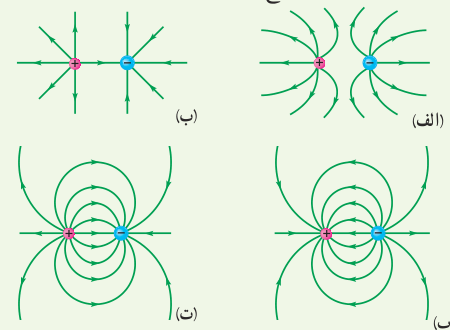
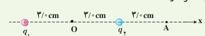
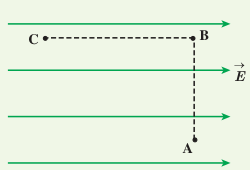
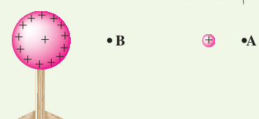
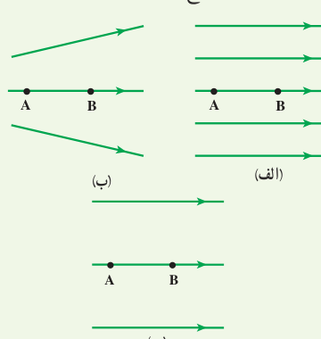

۱۲. در شکل‌های زیر، اندازۀ دو بار، یکسان ولی علامت آنها مخالف هم است. کدام آرایش‌های خطوط میدان نادرست است؟ دلیل آن را توضیح دهید.

۱۳. دو بار الکتریکی نقطه‌ای غیرهمنام $q_1=+1.0\ \mathrm{nC}$ و $q_2=-1.0\ \mathrm{nC}$ مطابق شکل زیر به فاصلۀ $6.0\ \mathrm{cm}$ از یکدیگر قرار دارند. الف) جهت و اندازۀ میدان الکتریکی را در نقطه‌های O و A به‌دست آورید. ب) آیا بر روی محور، نقطه‌ای وجود دارد که میدان خالص در آن صفر شود؟

۱۴. بادکنک باردار شکل زیر را به آب نزدیک کرده‌ایم. توضیح دهید چرا آب به‌جای اینکه به‌طور قائم فروریزد، خمیده می‌شود؟

### ۱ـ۷ و ۱ـ۸ انرژی پتانسیل الکتریکی و پتانسیل الکتریکی

۱۵. مطابق شکل زیر، بار $q=+50\ \mathrm{nC}$ را در میدان الکتریکی یکنواخت $8.0\times10^5\ \mathrm{N/C}$ نخست از نقطۀ A تا نقطۀ B و سپس تا نقطۀ C جابه‌جا می‌کنیم. اگر $AB=0.20\ \mathrm m$ و $BC=0.40\ \mathrm m$ باشد، مطلوب است:

الف) نیروی الکتریکی وارد بر بار $q$، ب) کاری که نیروی الکتریکی در این جابه‌جایی انجام می‌دهد، پ) تغییر انرژی پتانسیل الکتریکی بار $q$ در این جابه‌جایی.

۱۶. در شکل زیر ذرۀ باردار مثبت و کوچکی را از نقطۀ A به سمت کرۀ باردار که روی پایۀ عایقی قرار دارد، نزدیک می‌کنیم و در نقطۀ B قرار می‌دهیم. الف) در این جابه‌جایی، کار نیروی الکتریکی مثبت است یا منفی؟ ب) انرژی پتانسیل ذرۀ باردار در این جابه‌جایی چگونه تغییر می‌کند؟ پ) پتانسیل نقطه‌های A و B را با هم مقایسه کنید.

۱۷. شکل زیر سه آرایش خطوط میدان الکتریکی را نشان می‌دهد. در هر آرایش، یک پروتون از حالت سکون در نقطۀ A رها می‌شود و سپس توسط میدان الکتریکی تا نقطۀ B شتاب می‌گیرد. نقطه‌های A و B در هر سه آرایش در فاصله‌های یکسانی از هم قرار دارند. در کدام شکل سرعت پروتون در نقطۀ B بیشتر است؟ توضیح دهید.

