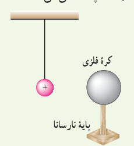
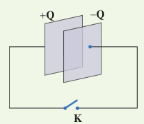

۱۸. دو صفحۀ رسانا با فاصلۀ $2.00\ \mathrm{cm}$ را موازی یکدیگر قرار می‌دهیم و آنها را به اختلاف پتانسیل $100\ \mathrm V$ وصل می‌کنیم. در نتیجه، یکی از صفحه‌ها به‌طور منفی و دیگری به‌طور مثبت باردار می‌شوند و میان دو صفحه میدان الکتریکی یکنواختی به‌وجود می‌آید. اندازۀ این میدان الکتریکی را حساب کنید و با توجه به جهت خطوط میدان الکتریکی در فضای بین دو صفحه توضیح دهید که کدام‌یک از دو صفحه پتانسیل الکتریکی بیشتری دارند.

۱۹. بار الکتریکی $q=-4.0\ \mathrm{nC}$ از نقطه‌ای با پتانسیل الکتریکی $V_1=-40\ \mathrm V$ تا نقطه‌ای با پتانسیل $V_2=-10\ \mathrm V$ آزادانه جابه‌جا می‌شود. الف) انرژی پتانسیل الکتریکی بار $q$ چه اندازه و چگونه تغییر می‌کند؟ ب) با توجه به قانون پایستگی انرژی، در مورد چگونگی تبدیل انرژی بار $q$ در این جابه‌جایی توضیح دهید.

### ۱ـ۹ توزیع بار الکتریکی در اجسام رسانا

۲۰. یک کرۀ فلزی بدون بار الکتریکی را که روی پایۀ نارسانایی قرار دارد، به آونگ الکتریکی بارداری نزدیک می‌کنیم. با ذکر دلیل توضیح دهید که چه اتفاقی می‌افتد.

### ۱ـ۱۰ خازن

۲۱. اگر ساختمان یک خازن را تغییر ندهیم، در هر یک از شرایط زیر ظرفیت خازن چگونه تغییر می‌کند؟ الف) بار آن دو برابر شود. ب) اختلاف پتانسیل میان صفحه‌های آن سه برابر شود.

۲۲. اختلاف پتانسیل بین دو صفحۀ یک خازن را از $28\ \mathrm V$ به $40\ \mathrm V$ افزایش می‌دهیم. اگر با این کار $15\ \mu\mathrm C$ بر بار ذخیره‌شده در خازن افزوده شود، ظرفیت خازن را حساب کنید.

۲۳. ظرفیت یک خازن تخت با فاصلۀ صفحات $1.0\ \mathrm{mm}$ که بین صفحه‌های آن هوا قرار دارد، برابر $1.0\ \mathrm F$ است. مساحت صفحه‌های این خازن چقدر است؟ از این مسئله چه نتیجه‌ای می‌گیرید؟

۲۴. یک خازن تخت به یک باتری بسته شده است تا باردار شود. پس از مدتی، درحالی‌که باتری همچنان به خازن متصل است، فاصلۀ بین صفحه‌های خازن را دو برابر می‌کنیم. کدام‌یک از موارد زیر درست است؟ الف) میدان الکتریکی میان صفحه‌ها نصف می‌شود. ب) اختلاف پتانسیل میان صفحه‌ها نصف می‌شود. پ) ظرفیت خازن دو برابر می‌شود. ت) بار روی صفحه‌ها تغییر نمی‌کند.

۲۵. مساحت هر یک از صفحه‌های خازن تختی، $1.00\ \mathrm{m^2}$ و فاصلۀ دو صفحه از هم، $0.500\ \mathrm{mm}$ است. عایقی با ثابت دی‌الکتریک ۴/۹ بین دو صفحه قرار داده شده است. ظرفیت خازن را تعیین کنید.

### ۱ـ۱۱ انرژی خازن

۲۶. دو صفحۀ خازن تخت بارداری را همانند شکل با بستن کلید به‌هم وصل می‌کنیم. در نتیجه جرقه‌ای زده می‌شود. حال اگر دوباره صفحات را به همان اندازه باردار کنیم ولی فاصلۀ آنها را دو برابر کنیم و سپس دو صفحه را به هم وصل کنیم، آیا جرقۀ حاصل بزرگ‌تر از قبل می‌شود، یا کوچک‌تر و یا تغییری نمی‌کند؟ توضیح دهید.

۲۷. ظرفیت خازن تختی $20\ \mathrm{nF}$ و بار الکتریکی آن $180\ \mathrm{nC}$ است. الف) انرژی ذخیره‌شده در این خازن چقدر است؟ ب) بین صفحات خازن هواست. خازن را از باتری جدا و فاصلۀ بین صفحه‌های آن را دو برابر می‌کنیم. انرژی ذخیره‌شده در خازن چقدر افزایش می‌یابد؟
