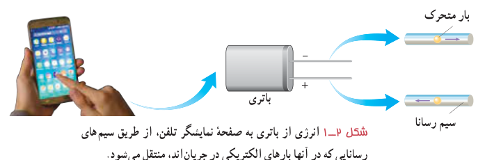
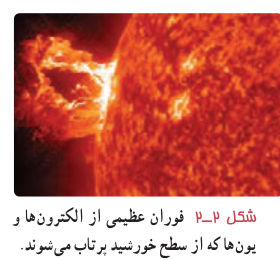
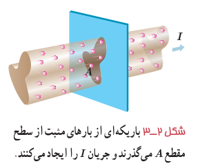
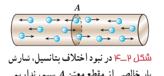
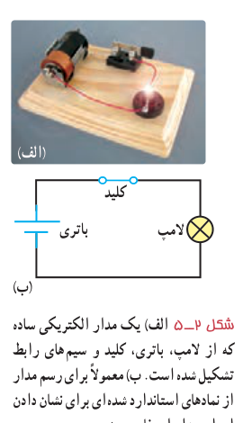

در فصل پیش با بار و میدان الکتریکی و همچنین اختلاف پتانسیل بین دو نقطه در میدان الکتریکی آشنا شدیم و به بررسی برهم‌کنش بارهای الکتریکی در حالت سکون پرداختیم. در این فصل به بررسی و مطالعۀ جریان الکتریکی و مدارهای جریان مستقیم می‌پردازیم.

مثال‌های فراوانی می‌توان از کاربردهای جریان الکتریکی ارائه کرد؛ مثلاً انرژی موردنیاز صفحۀ نمایشگر تلفن همراه توسط یک باتری تأمین می‌شود. انرژی الکتریکی از طریق مسیرهای رسانایی که در آنها بارهای الکتریکی در جریان‌اند به نمایشگر تلفن همراه می‌رسد (شکل ۲ـ۱). همچنین مهندسان برق با دستگاه‌های الکتریکی زیادی از قبیل مولدهای برق و دستگاه‌های ذخیرۀ اطلاعات سر و کار دارند و مهندسان مخابرات نگران اختلالات ناشی از فوران‌های خورشیدی (شکل ۲ـ۲) هستند. فیزیولوژیست‌ها و مهندسان پزشکی نیز با جریان‌های الکتریکی در رشته‌های عصبی سروکار دارند.

اکنون با این پرسش شروع می‌کنیم که چرا هر مجموعه‌ای از بارهای متحرک لزوماً جریان الکتریکی ایجاد نمی‌کنند؟ در واقع برای اینکه جریان الکتریکی داشته باشیم، باید یک انتقال خالص بار از یک سطح مقطع معین رخ دهد (شکل ۲ـ۳) که به این منظور نیاز به ابزاری مانند باتری داریم تا با ایجاد یک میدان الکتریکی، بارها را در جهت معینی به حرکت درآورد.

## ۲ـ۱ جریان الکتریکی

جریان الکتریکی ناشی از شارش بارهای متحرک است، ولی همۀ بارهای متحرک، جریان ایجاد نمی‌کنند. برای داشتن جریان الکتریکی باید یک شارش خالص بار از یک سطح مقطع معین داشته باشیم. به این منظور سیمی فلزی را در نظر بگیرید. الکترون‌های آزاد در طول این سیم با تندی‌هایی از مرتبۀ $10^6\ \mathrm{m/s}$ در حرکت‌اند، ولی این حرکت به‌طور کاتوره‌ای در همۀ جهت‌هاست. بنابراین، هیچ شارش خالص باری از مقطعی معین نداریم (شکل ۲ـ۴). ولی اگر این سیم را در مدار الکتریکی مانند شکل ۲ـ۵ قرار دهیم، اختلاف پتانسیلی در دو سر سیم و میدان الکتریکی درون آن ایجاد می‌شود و باعث حرکت الکترون‌های آزاد در سیم و ایجاد جریان می‌شود (شکل ۲ـ۶) به‌طوری که می‌تواند لامپ مدار ۲ـ۵ را روشن کند. در واقع میدان الکتریکی درون فلز طبق رابطۀ $\vec F=q\vec E=-e\vec E$ به الکترون‌های آزاد، در خلاف جهت میدان الکتریکی نیرو وارد می‌کند و سبب می‌شود الکترون‌ها حرکت کاتوره‌ای خود را کمی تغییر دهند و با سرعتی متوسط موسوم به سرعت سوق¹ در خلاف جهت میدان به‌طور بسیار آهسته‌ای سوق پیدا کنند که این موجب

۱ـ Drift Velocity
