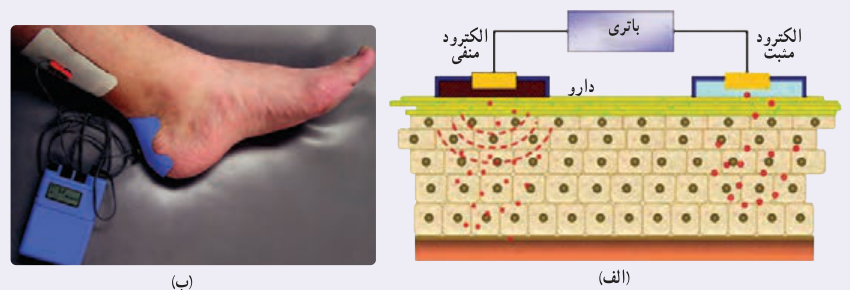
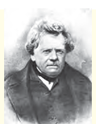

قرار می‌دهند. جریان از طریق پوست عبور می‌کند و دارو را به بافت آسیب‌دیده تا عمق حداکثر $1.7\ \mathrm{cm}$ می‌رساند (شکل الف). اگر پرستاری بخواهد مثلاً $80\ \mu\mathrm g$ دارو را با جریان متداول $0.14\ \mathrm{mA}$ به پای آسیب‌دیده برساند (شکل ب)، محاسبه نشان می‌دهد که این عمل ۱۵ دقیقه به طول خواهد انجامید.

## ۲ـ۲ مقاومت الکتریکی و قانون اهم

همان‌طور که در بخش قبل دیدیم وقتی در مداری الکتریکی کلید را می‌بندیم، اختلاف پتانسیل دو سر سیم سبب شارش خالص بارهای الکتریکی (الکترون‌ها) از یک سطح مقطع سیم در مدار می‌شود. این الکترون‌ها با اتم‌های رسانا که در حال نوسان‌اند برخورد می‌کنند و این موضوع باعث گرم شدن رسانا می‌شود. در واقع الکترون‌های آزاد هنگام حرکت در رسانا همیشه با نوعی مقاومت روبه‌رو هستند. اصطلاحاً می‌گوییم رسانا دارای مقاومت الکتریکی¹ است. از اینجا می‌توان پیش‌بینی کرد که مقاومت الکتریکی به ابعاد هندسی رسانا، یعنی طول و سطح مقطع رسانا بستگی دارد. همچنین جنس مادۀ رسانا و دمای آن بر مقاومت الکتریکی اثر می‌گذارد.

تحت یک اختلاف پتانسیل یکسان، دو سیم با مقاومت الکتریکی متفاوت، جریان‌های مختلفی را از خود عبور می‌دهند؛ به‌طوری که سیم با مقاومت کمتر، جریان بیشتری از خود عبور می‌دهد و بالعکس. از اینجا می‌توان مقاومت الکتریکی بین دو نقطه از یک رسانا را به صورت زیر تعریف کرد:

$$R=\frac VI\qquad (۲-۲)$$

در این رابطه مقاومت الکتریکی ($R$) برحسب ولت بر آمپر (V/A) می‌شود که به پاس خدمات علمی گئورگ سیمون اُهم، به نام اهم نام‌گذاری شده است و با نماد $\Omega$² نشان داده می‌شود. رسانایی را که دارای مقاومت الکتریکی مشخصی است، اصطلاحاً مقاومت³ می‌نامند و آن را در مدارهای الکتریکی با نماد مقاومت نمایش می‌دهند.

**گئورگ سیمون اهم (۱۸۵۴–۱۷۸۷ م)**

گئورگ سیمون اُهم در شهر باواریا آلمان متولد شد. گئورگ در ۱۸ سالگی به‌عنوان معلم ریاضی در یکی از مدارس سوئیس مشغول به کار شد. اهم مطالعاتش را در رشتۀ ریاضی دنبال کرد و در سال ۱۸۱۱ موفق به اخذ درجۀ دکترای ریاضی شد. در سی سالگی به کالجی در کلن رفت و به‌عنوان استاد ریاضی مشغول به کار شد. در سال ۱۸۲۸ او مقاله‌ای تحت عنوان «اندازه‌گیری‌های ریاضی جریان برق» را به چاپ رساند. او در این مقاله فرمول مشهور خود را ارائه کرد. در سال ۱۸۴۱ به دریافت بهترین نشان علمی انجمن سلطنتی انگلستان مفتخر گردید. در سال ۱۸۸۱ انجمن مهندسان برق جهان به اتفاق آرا یکای مقاومت الکتریکی را به نام «اهم» نام‌گذاری کردند.

۱ـ Resistance

۲ـ از حروف الفبای یونانی که اُمگا خوانده می‌شود.

۳ـ Resistor
