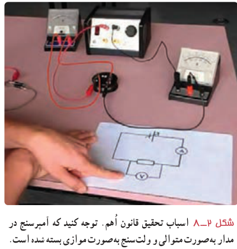
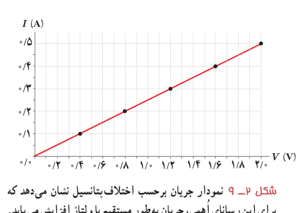
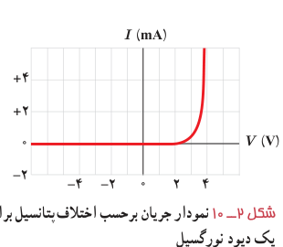

وسیله‌هایی که جریان الکتریکی را از خود عبور می‌دهند ممکن است با تغییر اختلاف پتانسیل اعمال‌شده و در نتیجه تغییر جریان عبوری، مقاومت ثابتی از خود بروز دهند و یا با تغییر اختلاف پتانسیل، مقاومتشان تغییر کند. برای تشخیص چنین وسایلی از هم، آزمایشی را تدارک می‌بینیم؛ به این ترتیب که وسیله را مانند شکل ۲ـ۸ به یک آمپرسنج (با نماد A)، یک ولت‌سنج (با نماد V) و یک منبع تغذیه با ولتاژ قابل تنظیم (دستگاهی که با آن می‌توان اختلاف پتانسیل را در دو سر مدار برقرار کرد و آن را تغییر داد) می‌بندیم. اختلاف پتانسیل دو سر وسیله را به کمک منبع تغذیه تغییر می‌دهیم و در هر نوبت جریان عبوری از وسیله و اختلاف پتانسیل دو سر آن را با آمپرسنج و ولت‌سنج مدار اندازه می‌گیریم و سپس با استفاده از رابطۀ ۲ـ۲ مقاومت الکتریکی را محاسبه و نتایج را در جدولی یادداشت می‌کنیم. اگر مقاومت الکتریکی در ولتاژهای مختلف (در دمای ثابت)، مقدار ثابتی باشد، اصطلاحاً گفته می‌شود آن وسیله از قانون اهم پیروی می‌کند و آن وسیله را مقاومت یا رسانای اهمی می‌نامند. به عبارتی جریان عبوری از یک مقاومت اهمی همواره با اختلاف پتانسیل اعمال‌شده به دو سر آن رابطۀ مستقیم دارد.

این قانون برای فلزات و بسیاری از رساناهای غیر فلزی در دمای ثابت برقرار است. جدول ۲ـ۱ مقادیر اندازه‌گیری شده برای جریان و اختلاف پتانسیل یک مقاومت را نشان می‌دهد که از قانون اهم پیروی می‌کند. همان‌طور که نمودار شکل ۲ـ۹ نشان می‌دهد جریان با ولتاژ برای این وسیله به‌طور خطی افزایش می‌یابد.

**جدول ۲ـ۱ مقادیری نوعی برای یک رسانای اهمی**

| اختلاف پتانسیل V (V) | جریان I (A) | مقاومت R (Ω) |
|---|---|---|
| ۰/۴ | ۰/۱ | ۴ |
| ۰/۸ | ۰/۲ | ۴ |
| ۱/۲ | ۰/۳ | ۴ |
| ۱/۶ | ۰/۴ | ۴ |
| ۲/۰ | ۰/۵ | ۴ |

با این حال وسیله‌های زیادی نیز یافت می‌شود که از این قانون پیروی نمی‌کنند. یکی از این وسیله‌های غیراهمی، دیود نورگسیل (LED) است که با آن بعداً آشنا می‌شویم. نمودار جریان برحسب اختلاف پتانسیل چنین دیودی تقریباً شبیه شکل ۲ـ۱۰ است.

